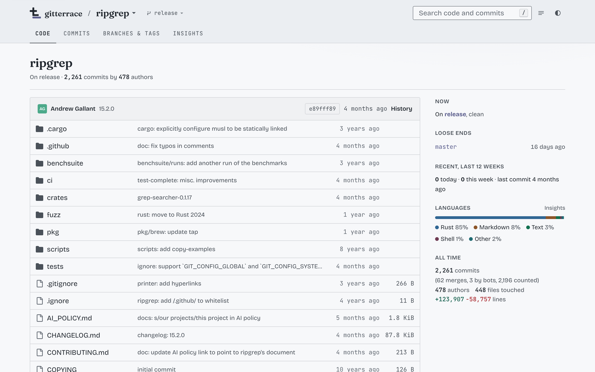

<h1 align="center">
<picture>
  <source media="(prefers-color-scheme: dark)" srcset="docs/brand/readme-header-dark.svg">
  
</picture>
</h1>

Browse any git repository in your browser, offline, read-only: code, commits, blame,
branches, worktrees, stashes, live updates and insights. No database, accounts or network.
Agents write more of the code each month, and few people read their diffs. This is a calm
place to look again ([why](docs/why.md)).

<!-- BEGIN GENERATED: demo -->
Try it without installing: [the live demo](https://demo.gitterrace.dev): jq 1.8.2 and ripgrep
15.2.0, exported.

<!-- END GENERATED: demo -->

<!-- BEGIN GENERATED: shots -->
<picture>
<source media="(prefers-color-scheme: dark)" srcset="docs/screenshots/overview-dark.png">

</picture>

<!-- END GENERATED: shots -->

## Install

<!-- BEGIN GENERATED: msrv -->
Rust 1.96 or newer.

<!-- END GENERATED: msrv -->
<!-- BEGIN GENERATED: install -->
```bash
curl -fsSL https://gitterrace.dev/install.sh | sh
brew install gitterrace/tap/gitterrace
cargo install --locked --git https://github.com/gitterrace/gitterrace gitterrace
```

Installs `git-terrace`; git runs it as `git terrace`.

<!-- END GENERATED: install -->
Windows: releases ship a zip. Config lives in `%APPDATA%\gitterrace` and the repo registry in
`%LOCALAPPDATA%\gitterrace`. `install-handler` prints the `reg add` commands instead of writing
the registry.

## Quickstart

```bash
cd path/to/any/git/repo
git terrace          # serves on 127.0.0.1 and opens your browser
cd ../another/repo
git terrace          # joins the server already running, no second port
```

Every repository lives under `/r/<name>/`, also the first, so its links stay valid as
others join. Run `git terrace` in a second repository while one is served and it joins that
server: the repository appears under `/r/<name>/` and in the switcher, and the command exits.
This works for the same user on a loopback address. `--public` servers never take repositories
this way. `git terrace remove [path|name]` takes one off again (the last one stays). There is
no remove button in the page: a browser has no secret, and a page may be on someone's screen.

## Commands

<!-- BEGIN GENERATED: commands -->
```text
git terrace [paths]          Browse a git repository in your browser, offline [--addr --interval-ms --no-watch --config --no-actions --public]
git terrace serve            Serve the repository in the browser (the default)
git terrace config           Print the effective configuration and where each value comes from
git terrace mcp              Run a read-only MCP server over stdio for agents
git terrace wrapped          Write the year-in-review card for the repository [--year --layout --theme --out]
git terrace open <link>      Open a `gitterrace://` or `/go` permalink in the browser, starting a server if needed [--print]
git terrace remove [target]  Take a repository off the running server; its pages then answer 404
git terrace install-handler  Register (or with `--uninstall` remove) this program as the `gitterrace://` link handler [--uninstall]
git terrace init             Write a documented `config.toml` and the pre-filled `actions.toml` to the config folder
git terrace export [out]     Write a static copy of the site to a folder, for sharing or hosting [--force --commits --file-kb --export-pages --project]
```

<!-- END GENERATED: commands -->

<!-- BEGIN GENERATED: actions -->
Run your own program on a selection (`line`, `file`, `commit`, `hunk`, `blame`, `search-hit`,
`insight`, `page`). Examples in `docs/actions/`: `clipboard.sh`, `editor.sh`, `obsidian.sh`.

<!-- END GENERATED: actions -->
Send a selection to a tracker, notes app or mail draft, or run your own program on it. Off until
you write `actions.toml`: [how to set it up](docs/actions.md).

Every document, by what you need: [the docs index](docs/README.md). Most used:
[configuration](docs/configuration.md), [JSON API](docs/api.md) and
[running it online](docs/online.md). gitterrace binds to `127.0.0.1` and never changes your files
or history. The one-page site is generated into [site/](site/index.html).

## Contributing

Issues and pull requests are welcome: see [contributing](CONTRIBUTING.md), and report
vulnerabilities privately as [SECURITY.md](SECURITY.md) describes. A human sets the direction and
decides ([how it is made](docs/why.md#how-it-is-made)).

## License

<!-- BEGIN GENERATED: license -->
MIT, see [LICENSE](LICENSE).

<!-- END GENERATED: license -->
