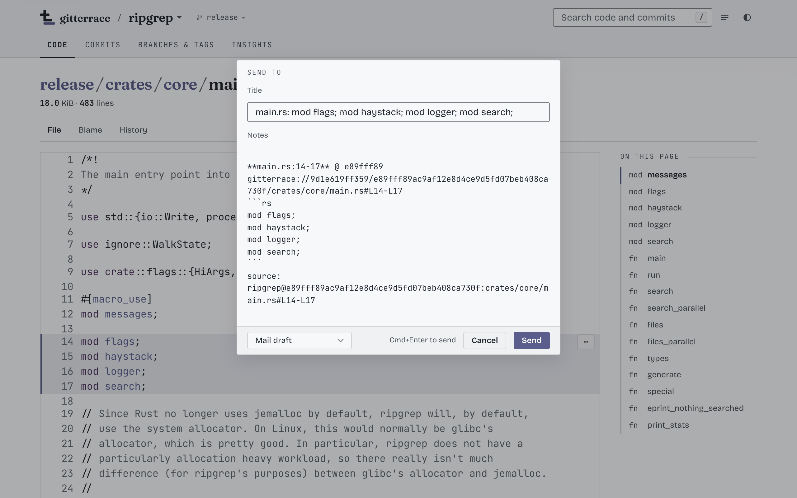

<h1 align="center">
<picture>
  <source media="(prefers-color-scheme: dark)" srcset="docs/brand/readme-header-dark.svg">
  
</picture>
</h1>

<!-- BEGIN GENERATED: pitch -->
Review your repo before you push, and hand findings to any tool.

<!-- END GENERATED: pitch -->

Code, commits, blame, branches, worktrees, stashes and insights, with no
database, accounts or network ([why](https://gitterrace.dev/docs/why/)).
gitterrace never writes your repository or your working tree: no object, ref,
config or working file changes. It keeps one folder of its own,
`.git/gitterrace/`, for the index and, from 0.2.1, your checkpoints, viewed
marks and review notes. Delete the folder at any time: the index rebuilds, and
the marks and notes are forgotten. A checkpoint holds copies of changed text
files from your working tree (never ignored or binary files), so treat that
folder like the repository.

Pass what you find to any agent, editor, tracker or script you already use, or
read the same data over the [JSON API and the MCP server](https://gitterrace.dev/docs/api/).

<!-- BEGIN GENERATED: demo -->
Try it without installing: [the live demo](https://demo.gitterrace.dev): jq
1.8.2, ripgrep 15.2.0 and gitterrace v0.2.0, exported.

[The screenshots](docs/screenshots/) show the open source projects
[jq](https://github.com/jqlang/jq/tree/jq-1.8.2) and
[ripgrep](https://github.com/BurntSushi/ripgrep/tree/15.2.0), used under their
MIT licenses. They are not affiliated with gitterrace. Thanks to their authors
for great tools.

<!-- END GENERATED: demo -->

<!-- BEGIN GENERATED: shots -->
<picture>
<source media="(prefers-color-scheme: dark)" srcset="docs/screenshots/send-dark.webp">

</picture>

<!-- END GENERATED: shots -->

## Install

<!-- BEGIN GENERATED: install -->
```bash
brew install gitterrace/tap/gitterrace
curl --proto '=https' --tlsv1.2 -fsSL https://gitterrace.dev/install.sh | sh
cargo install --locked --git https://github.com/gitterrace/gitterrace gitterrace
```

Installs `git-terrace`, which git runs as `git terrace`.

<!-- END GENERATED: install -->

<!-- BEGIN GENERATED: msrv -->
Building with cargo needs Rust 1.96 or newer.

<!-- END GENERATED: msrv -->

## Quickstart

<!-- BEGIN GENERATED: quickstart -->
```bash
cd path/to/any/git/repo
git terrace          # serves on http://127.0.0.1:4242, open it in your browser
cd ../another/repo
git terrace          # joins the server already running, no second port
```

<!-- END GENERATED: quickstart -->

Next: [getting started](https://gitterrace.dev/docs/getting-started/) and
[using it](https://gitterrace.dev/docs/using/). Docker serves read-only at
`http://localhost:8080`
([run with Docker](https://gitterrace.dev/docs/online/#run-with-docker)).

## Send a finding with its context

Review a change before you push it, then send each finding on: back to an
agent, or as a task or ticket. Open **Working tree** (`/worktree`) for your
uncommitted changes, or any file, diff or commit. Select the lines, press `.`
and pick a **Send to** target. The note carries the marked source lines and
ends with a line agents and scripts can parse:

```text
source: <repo>@<sha>:<path>#L<a>-L<b>
```

`<sha>` is the full commit id, so the reference holds after more commits.
Without a target, **Copy as markdown** puts the same note on the clipboard.

## Commands

<!-- BEGIN GENERATED: commands -->
```text
git terrace [paths]           Browse a git repository in your browser, offline [--addr --no-watch --config --no-actions --public --ref --print]
git terrace serve             Serve the repository in the browser (the default)
git terrace config            Print the effective configuration and where each value comes from
git terrace mcp               Run a read-only MCP server over stdio for agents [--served]
git terrace insights [name]   Print one insight of the first repository as JSON, or list them: the numbers of the web pages, `/api/v1/insights/{name}` and the MCP `insight` tool, byte for byte. Reads the repository of the current folder, offline [--rev --period --q --label --metric --limit --json]
git terrace open <link>       Open a `gitterrace://` or `/go` permalink in the browser, starting a server if needed [--print]
git terrace launch            Open the running server in the browser as its owner, so actions and settings can write [--print]
git terrace remove [target]   Take a repository off the running server. Its pages then answer 404
git terrace install-handler   Register (or with `--uninstall` remove) this program as the `gitterrace://` link handler [--uninstall]
git terrace service <action>  Run the server at login: print, install or uninstall a systemd user unit or launchd agent [--now]
git terrace init              Write a documented `config.toml` and the pre-filled `actions.toml` to the config folder
git terrace export [out]      Write a static copy of the site to a folder, for sharing or hosting [--force --commits --file-kb --export-pages --quiet --project]
```

<!-- END GENERATED: commands -->

<!-- BEGIN GENERATED: actions -->
Run your own program on a selection (`line`, `file`, `commit`, `hunk`, `blame`,
`search-hit`, `insight`, `page`). Examples in `docs/actions/`: `agent.sh`,
`clipboard.sh`, `editor.sh`, `obsidian.sh`.

<!-- END GENERATED: actions -->

Or send it to a tracker, notes app or mail draft. Mail draft works out of the
box. `git terrace init` writes `actions.toml` with the other targets, switched
off until you enable them ([set up](https://gitterrace.dev/docs/actions/)).

gitterrace binds to `127.0.0.1` and never changes your files or history
([security model](https://gitterrace.dev/docs/security/)). All docs:
[gitterrace.dev/docs](https://gitterrace.dev/docs/).

## Contributing

Issues and pull requests are welcome: see [contributing](CONTRIBUTING.md).
Report vulnerabilities privately ([SECURITY.md](SECURITY.md)).

## License

<!-- BEGIN GENERATED: license -->
MIT, see [LICENSE](LICENSE).

<!-- END GENERATED: license -->
