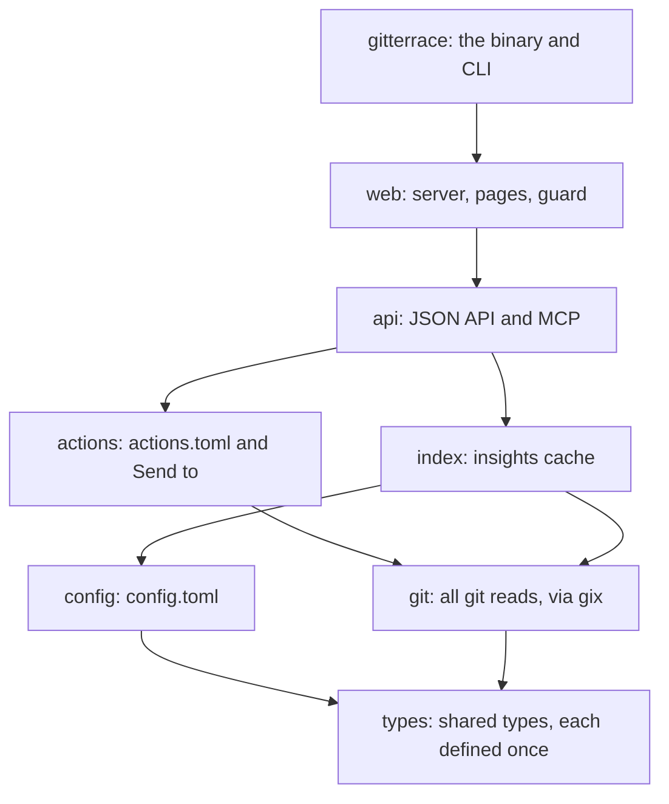

# Architecture

<!-- BEGIN GENERATED: crates -->

<!-- END GENERATED: crates -->

Each box is a crate the binary ships, and an arrow means "uses" (implied arrows
left out). `testkit` is test-only. `schwarzwald` is the vendored shared kit:
theme, lints, hooks and guards.

The API crate's entry points: `gitterrace_api::router(ApiState)` (nest under
`/api/v1`), `gitterrace_api::serve_mcp(path, config)` and
`gitterrace_api::serve_mcp_repos(scope, repos, config)`. The naming rule for
config keys lives in `gitterrace_config::naming`.

## Decisions

- **The theme is a snapshot, not a design.** Colors, type, space and motion come
  only from `vendor/schwarzwald/kit/`, replaced as a whole, never edited.
  `xtask/src/theme.rs` writes the block in `tokens.css`.
  `make theme` fails on drift. Components use the role aliases, never a raw
  color, and charts are server-rendered SVG colored by class.
- **Read-only, pinned.** Every read takes a resolved commit id, so a commit
  landing mid-request cannot tear a page. Only the uncommitted view reads the
  worktree.
- **Browsing never waits on the cache.** Only insights pages show "Indexing
  history" while the index builds. The overview shows no progress.
- **The index builds in a child process.** The server starts its own executable
  again to update the cache, then reads the segment set from disk. The build's
  peak (allocator metadata, worker stacks) exits with the child, so an idle
  server holds the same at 100k commits as at 2k
  (`gitterrace-web/src/app/child.rs`).
- **Assets are versioned by build.** Every `/static/` asset is linked as
  `/static/<name>?v=<build hash>` (`asset_url` in
  `gitterrace-web/src/routes/assets.rs`). At the current version it is
  immutable for a year, otherwise `no-cache`. Exports keep `/static/*` a year,
  and the site versions `/assets/*` by content sha.
- **One guard** (`gitterrace-web/src/guard.rs`): loopback Host, no cross-site
  requests, hashed inline script CSP.
- **Live.** A watcher pushes changes over `/events`, and config files reload on
  change, and a joining repository appears in open switchers. OS file events
  watch the git folder always and the working tree while a tab shows it. A burst
  of events is one cheap check. Dropped events (a loaded Mac) are caught by the
  `watch.rescan_secs` rescan (30 by default). Without file events the server
  checks once a second.
- **Features switch off at the route.** Each `[features]` switch owns its routes
  (`gitterrace-web/src/features.rs`). One gate answers an off route with 404,
  and pages ask the same table, so no link is left behind. Off always wins.
- **Markdown renders as the hosts do.** Heading anchors are the plain slugs
  (`#getting-started`). Only an id the page itself uses gets a prefix.
- **Every repo under `/r/{name}/`**, also when it is the only one, resolved only
  through the repository table. `/` forwards to a lone repository and lists
  several. A link never moves when another repository joins.
  `/go/{repo-id}/{sha}` is the permalink and outlives names.
- **A name is assigned once:** the folder name, URL-safe and lowercase. A clash
  gets `-` and six hex digits of its path, and the first keeps the plain name.
  Names persist in `repos.json`, so a restart serves each where it was. Without
  a state folder the rule runs against the table alone.
- **A running server grows, it is never replaced.** `git terrace open` and a
  second `git terrace` add repositories through `POST /_repos`, and
  `git terrace remove` takes one off with `DELETE /_repos`. The gate (loopback
  only, browser headers refused, a 0600 token, a nonce check of the listener) is
  in [SECURITY.md](../SECURITY.md). A foreign listener gets no path: `open`
  starts its own server and `serve` binds as usual. A second `serve` opens every
  root before it adds any, then exits 0. Once adding starts, a refused add is an
  error, never a bind on the held address. `--public` never joins. Removal keeps
  the index and name, stops its refresher and drops it from open switchers. The
  last repository stays. No page offers remove, since a page has no token. An
  added repository gets what a startup one does, and one holding `actions.toml`
  is refused.
- **`gitterrace://` permalinks name what, not where.**
  `gitterrace://<repo-id>/<sha>/<path>` is the `/go` tuple without a host.
  `git terrace open` finds the clone among repositories served before
  (`$XDG_STATE_HOME/gitterrace/repos.json`, else `~/.local/state/gitterrace`)
  and under `links.roots`, and rechecks its id. A link is input from outside:
  one strict parser in `gitterrace-actions/src/link.rs`, nothing from a link is
  stored, and an unknown id never clones or fetches.

## Cache

<!-- BEGIN GENERATED: cache -->
| File | Holds |
| --- | --- |
| `VERSION` | The cache format, `v` and the number. A mismatch deletes the cache and rebuilds it. The format is never migrated. |
| `lock` | Empty. Held locked by whichever process is extending the segment set, so two processes on one repository take turns instead of building on one manifest. |
| `owner` | Only in a cache outside the repository: the real path of the git dir it belongs to. Another path there wipes the cache, so a hash collision rebuilds. |
| `tip` | The commit id the segment files were last built for. Opening insights for that commit skips walking its history to check the files hold exactly it. |
| `lines.json` | Line counts per blob id for the language chart. A blob never changes, so the counts never go stale. |
| `chain.state` | Languages chain totals, checkpointed every 64 commits; a newer tip walks only new commits. Read only whole, under its rules key. |

The format version is `2`, stored as `v2`.

<!-- END GENERATED: cache -->

The cache lives in `.git/gitterrace/` when that folder is writable, else in
`$GITTERRACE_INDEX_FALLBACK/<hash of the git dir>` (the Docker image sets
`/cache/index`), else nowhere.

The index is a set of immutable files named by one manifest, swapped by rename,
so a crash leaves the previous complete set. Pages read bounded, checksummed
blocks and never load the history: memory while serving is a fixed budget
(`resources.cache_mb`), whatever the length of the history. Commit search reads
a compressed message column in the same files instead of walking git. If the
cache cannot be read it is deleted and rebuilt, never partly served.

How the files are laid out, how search reads them, the memory budget and the
seam pages read through are in
[the index internals](../crates/gitterrace-index/src/seg/internals.md), next to
the [store design](../crates/gitterrace-index/src/seg/store.md).

### How the languages page reads the index

The languages page charts lines per language along the first-parent history.
The page walks the first parents through the stored records, newest first, and
reads each walked commit's file rows in bounded batches.

Rows are keyed by path, and the language and path filters apply when the page is
built, so changing them needs no rebuild.

Format numbers: the cache format (`VERSION`, `FORMAT_VERSION` in `store.rs`) is
stored with a `v` prefix, and a bare number without it is reset, not
refused. The container byte version (`seg/format.rs`) is separate.

### How hotspots and ownership read the index

A per-path aggregate cannot serve these pages, since a renamed or reused name
belongs to two files (over half of rust's files at HEAD). Every update writes
`tip-<gen>.gts` (`tip.rs`): each commit's file rows keyed by the name at the
indexed tip, with churn. Hotspots, ownership, coupling and code age read it, and
a set without it reads the commit rows directly.

`crates/gitterrace-index/tests/latency.rs` holds today's times on a 100k-commit
synthetic history as ceilings, and
`crates/gitterrace-web/tests/memory_budget.rs` guards serving memory on
synthetic repositories of growing size.

The bench harness is `scripts/bench/bench-run.py`, the corpus is
`tests/bench/corpus.toml`, and results land in
`tests/bench/results/<date>-<machine>.json`, the machine label from the CPU (for
example `apple-m1-max`).

## Routes

Every row from `/` to `/api/v1` is per repository and lives under `/r/{name}`,
also when one repository is served. The rest are the server's own and never take
the prefix.

<!-- BEGIN GENERATED: routes -->
| Route | Shows |
| --- | --- |
| `/` | README, last commit, file list, key numbers. The server's own `/` forwards to the one repository, or lists several |
| `/tree`, `/blob`, `/raw`, `/blame` `/{rev}/{path}` | Files: listing, highlighted view (large files load in chunks), bytes, authorship |
| `/log/{rev}`, `/history/{path}`, `/compare` | Commits, one file's history, two revisions |
| `/commit/{id}`, `/diff/{rev}/{index}` | A commit's diff, large files fold and load on demand |
| `/refs`, `/tag/{name}`, `/worktrees`, `/stashes`, `/worktree`, `/worktree/diff/{path}`, `/worktree/raw/{path}`, `/worktree/blob/{path}` | Git state: branches, tags, linked worktrees, stashes and uncommitted changes, each changed file as diff, bytes or page |
| `/search` | Code and commit search |
| `/stats`, `/stats/{page}` | Insights on the shared filter and period: activity (with commit types and code frequency), contributors, hotspots (with patterns), languages, ownership. `?rev=` follows any ref |
| `/events`, `/api/{files,refs,last,progress}` | Live updates and the fragments pages fetch |
| `/api/v1/...` | JSON API, see [api.md](api.md) |
| `/go/{repo-id}/{sha}/{path}` | Permalink: finds the served repository by id |
| `/_send/targets` | Send to targets as JSON template parts, filled in by the page |
| `/r/{name}/...`, `/api/repos` | The prefix of every per-repository row above, also when one is served; and the server-wide list the switcher reads |
| `/_dirty` | The repositories with uncommitted work, as JSON the home page fetches to fill its chips after the rows render |
| `POST /_repos`, `DELETE /_repos`, `GET /_repos?nonce=N` | Adds a repository to the running server for `git terrace open`, or takes one off for `git terrace remove`: loopback, no browser, secret from a 0600 file. The GET proves the secret by hashing it with the nonce |
| `/_settings`, `/_settings/file`, `POST /_settings/check` | The settings page: a form and a plain editor for `config.toml` and `actions.toml`, read, checked and saved on local servers only, same-origin with the page token, never a path from the request |

<!-- END GENERATED: routes -->

## Security guards

Each door in [security](security.md) and what holds it in the code:

| Door                       | Holds it                                                         | Test                                                   |
| -------------------------- | ---------------------------------------------------------------- | ------------------------------------------------------ |
| Every request              | `guard.rs`: Host allowlist, `Sec-Fetch-Site`, nosniff, CORP, CSP | `guard.rs` tests, `security_class_tests`               |
| Page routes (`PUBLIC`)     | `restrict_to_committed` when public, time bound                  | `public.rs` tests                                      |
| Local routes (`LOCAL`)     | `only_public` 404s anything not in `PUBLIC`                      | `every_local_route_is_dark_on_a_public_server`         |
| Path tails                 | Tree lookup, the worktree reader canonicalizes the parent        | `no_path_route_reads_outside_the_tree`                 |
| `/raw`                     | `sandbox` CSP for SVG and text, PDF attachment, size cap         | `wiring_tests`, `security_class_tests`                 |
| `POST /_actions/run`       | `same_origin_write`, JSON only, `config/trust.rs`                | `run_route_security_table`                             |
| `/_settings/*`             | `same_origin_write`, enum file choice, stamp                     | `settings/tests.rs`                                    |
| `/_repos`                  | Add token from a 0600 file, browser headers refused              | `add/tests.rs`                                         |
| Every non-GET method       | Tokenless writes never succeed                                   | `no_write_succeeds_without_the_token`                  |
| MCP server                 | Read-only tools, the switches of `/api/v1`                       | `mcp_tools_follow_the_switches_of_the_web_api`         |
| `open` and `gitterrace://` | Strict link parse, known clones only                             | `open` tests                                           |
| Static export              | `_headers` carries the CSP, no local routes crawled              | `export/tests.rs`                                      |
| Hostile content            | Askama escaping, CSP, actions never from the repository          | `hostile_repo_content_is_escaped_where_the_menu_lives` |

`security_class_tests.rs` reads every route from the built routers, so a route
registered anywhere is walked: public or `LOCAL`, in the sitemap, dark when
public, headers on every method, path escapes in the tail and in `?path=`,
`?file=` and `?doc=`, and tokenless writes.

## Syntax highlighting

Code, diffs, blame and fenced blocks in markdown are highlighted with the
grammars of [bat](https://github.com/sharkdp/bat) (through `two-face` and
`syntect`), compiled into the binary. A file is matched by name, then extension,
then its `#!` line. Text over `limits.highlight_kb` (default 256 KiB) shows
plain. These are the languages:

<!-- BEGIN GENERATED: languages -->
182 languages: ActionScript, Ada, Apache Conf, AppleScript, ARM Assembly,
AsciiDoc (Asciidoctor), ASP, Authorized Keys, AWK, Batch File, BibTeX, Bourne
Again Shell (bash), C, C#, C++, Cabal, CFML, Clojure, CMake, CMake C Header,
CMake C++ Header, CMakeCache, CoffeeScript, Command Help, CpuInfo, Crontab,
Crystal, CSS, D, Dart, debsources, Diff, Dockerfile, DotENV, Elixir, Elm, Email,
Erlang, F#, Fish, Fortran (Fixed Form), Fortran (Modern), Fortran Namelist,
fstab, GDScript (Godot Engine), Git Attributes, Git Commit, Git Config, Git
Ignore, Git Link, Git Log, Git Mailmap, Git Rebase Todo, GLSL, gnuplot, Go,
Gomod, Gosum, GraphQL, Graphviz (DOT), Groff/troff, Groovy, group, Haskell,
Highlight non-printables, Hosts File, HTML, HTML (ASP), HTML (EEx), HTML
(Erlang), HTML (Jinja2), HTML (Rails), HTML (Tcl), HTML (Twig), HTTP Request and
Response, Idris, INI, Java, Java Properties, Java Server Page (JSP), JavaScript,
JavaScript (Babel), JavaScript (Rails), Jinja2, JQ, JSON, jsonnet, Julia, Known
Hosts, Kotlin, LaTeX, Lean 4, Less, Lisp, Literate Haskell, LiveScript, LLVM,
log, Lua, Makefile, Manpage, Markdown, MATLAB, MediaWiki, MemInfo, NAnt Build
File, nginx, Nim, Ninja, Nix, NSIS, Objective-C, Objective-C++, OCaml, OCamllex,
OCamlyacc, Odin, orgmode, Pascal, passwd, Perl, PHP, PowerShell, Protocol
Buffer, Protocol Buffer (TEXT), Puppet, PureScript, Python, QML, R, Racket, Rd
(R Documentation), Rego, Regular Expression, Requirements.txt, resolv,
reStructuredText, Robot Framework, Ruby, Ruby Haml, Ruby on Rails, Ruby Slim,
Rust, Salt State (SLS), Sass, Scala, SCSS, Separated Values, SML, Solidity, SQL,
SQL (Rails), SSH Config, SSHD Config, Strace, Stylus, Svelte, Swift, syslog,
SystemVerilog, Tab Separated Values, Tcl, Terraform, TeX, Textile, Todo.txt,
TOML, TypeScript, TypeScriptReact, Typst, varlink, Verilog, VHDL, VimHelp, VimL,
Vue Component, Vyper, WGSL, x86_64 Assembly, XML, YAML, Zig.

<!-- END GENERATED: languages -->
