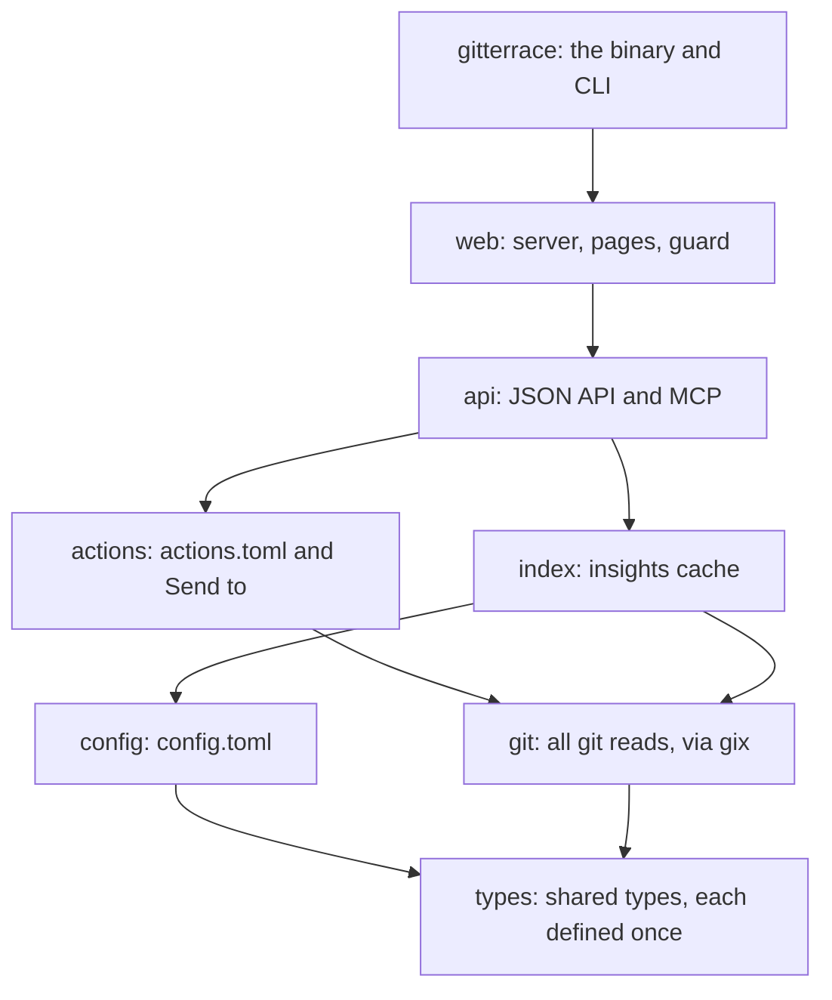

# Architecture

<!-- BEGIN GENERATED: crates -->

<!-- END GENERATED: crates -->

Each box is a crate the binary ships, and an arrow means "uses". An arrow
already implied by a longer path is left out, so `web` and `api` use `config`
too, though only `actions` points at it. `config` reads `config.toml` and knows
nothing else. `testkit` is not drawn, since only tests use it. `schwarzwald` is
the vendored theme.

## Decisions

- **The theme is a snapshot, not a design.** Colors, type, space and motion come
  only from `schwarzwald/kit/`, replaced as a whole, never edited.
  `scripts/theme-gen.py` writes the block in `tokens.css`. `make theme` fails on
  drift. Components use the role aliases, never a raw color, and charts are
  server-rendered SVG colored by class.
- **Read-only, pinned.** Every read takes a resolved commit id, so a commit
  landing mid-request cannot tear a page. Only the uncommitted view reads the
  worktree.
- **Browsing never waits on the cache**, and insights show progress.
- **One guard** (`gitterrace-web/src/guard.rs`): loopback Host, no cross-site
  requests, hashed inline script CSP.
- **Live.** A watcher pushes changes over `/events`, and config files reload on
  change. A repository that joins the server is announced the same way, so open
  pages show it in the switcher without a reload. Changes come from the OS's
  file events: a few watches on the git folder (HEAD, refs, `packed-refs`, the
  index) at all times, and the working tree while a tab shows it. Each event
  triggers a cheap check of what moved, and a burst is one check. A new commit
  or an edit usually shows within about a second. On a heavily loaded Mac the OS
  can drop a file change silently, and then it shows within `watch.rescan_secs`
  (30 by default), the setting to lower for a tighter bound. With no tab open
  nothing wakes more often than that. Where file events are unavailable (the
  watch limit, some network volumes) the server checks once a second instead.
- **Features switch off at the route.** Each `[features]` switch owns its routes
  (`gitterrace-web/src/features.rs`), and one gate answers a route of an off
  feature with the 404 of an unknown page. Pages ask the same table, so an off
  feature leaves no link or menu entry behind. Off always wins: the file narrows
  what public mode and the loopback checks allow, never widens it.
- **Markdown renders as the hosts do.** Heading anchors are the plain slugs most
  Markdown hosts make (`#getting-started`), so links written for elsewhere land.
  Only an id the page itself uses gets a prefix. Front matter shows as a table
  (`features.front_matter_enabled`), and a long document gets an "On this page"
  outline from its headings.
- **Dates read relative, the full date is a hover away** (`display.dates`).
- **Send to opens a URL in your browser.** The server never calls the
  destination, so there is nothing to authenticate and nothing written
  ([how Send to works](actions.md)).
- **Every repo under `/r/{name}/`**, also when it is the only one, resolved only
  through the repository table. `/` forwards to a lone repository and lists
  several. A link never moves when another repository joins.
  `/go/{repo-id}/{sha}` is the permalink and outlives names.
- **A name is assigned once.** It is the folder name made URL-safe and
  lowercase. A folder whose name another folder already holds gets `-` and six
  hex digits of its path. The first to arrive keeps the plain name. The name is
  kept in `repos.json` in the state folder, so a restart in any order serves
  each repository where it was. Without a state folder the same rule runs
  against the table alone.
- **A running server grows, it is never replaced.** Every server keeps a
  repository table and serves added ones under `/r/{name}/` beside the rest.
  `git terrace open` adds a repository the server lacks through `POST /_repos`
  instead of starting a second server, and so does a second `git terrace` on an
  address a gitterrace server already holds: it hands over its repositories and
  exits 0. Before it sends a path it asks `GET /_repos?nonce=N`, and the server
  must answer the SHA-256 of its secret and that nonce. A listener that cannot,
  or a missing secret, counts as foreign: `open` starts its own server and
  `serve` binds as usual. A second `serve` opens every root before it adds any.
  Once adding starts, a refused add is an error. It never falls through to a
  bind on the held address. `--public` never joins. That route makes the server
  read a path it was not started with, so a browser can never reach it: it
  exists only on a loopback bind, it refuses any `Origin` or `Sec-Fetch-Site`,
  and it needs a per-process secret the server writes 0600 into the state
  folder. The path must be canonical and a repository's top folder.
  `git terrace remove` sends `DELETE /_repos` through the same gate: its URLs
  answer 404, its refresher and warm-up stop, open switchers drop it, and its
  on-disk index and name stay for a fast re-add. The last repository stays, so
  `/` always has one (it forwards there when one is left). No page offers
  remove, since a page has no secret and may be seen by others. An added
  repository gets what a startup one does: its own refresher and warm-up,
  permalinks, actions and the switcher. A repository holding `actions.toml` is
  refused, as at start.
- **`gitterrace://` permalinks name what, not where.**
  `gitterrace://<repo-id>/<sha>/<path>` is the `/go` tuple without a host, so it
  works with no server running and on another machine. `git terrace open` finds
  the clone among repositories served before (recorded in
  `$XDG_STATE_HOME/gitterrace/repos.json`, else `~/.local/state/gitterrace`, on
  macOS too) and under `links.roots`, rechecks its id, then starts or reuses a
  server. A link is input from outside: one strict parser in
  `gitterrace-actions/src/link.rs`, the registry never stores anything from a
  link, and an unknown id never clones or fetches.

## Cache

<!-- BEGIN GENERATED: cache -->
| File | Holds |
| --- | --- |
| `VERSION` | The cache format, `v` and the number. A mismatch deletes the cache and rebuilds it. The format is never migrated. |
| `lock` | Empty. Held locked by whichever process is extending the segment set, so two processes on one repository take turns instead of building on one manifest. |
| `owner` | Only in a cache outside the repository: the real path of the git dir it belongs to. Another path there wipes the cache, so a hash collision rebuilds. |
| `tip` | The commit id the segment files were last built for. Opening insights for that commit skips walking its history to check the files hold exactly it. |
| `lines.json` | Line counts per blob id for the language chart. A blob never changes, so the counts never go stale. |

The format version is `1`, stored as `v1`.

<!-- END GENERATED: cache -->

Disposable: bump the format version instead of migrating.

The cache lives in `.git/gitterrace/` and is used there whenever that folder can
be written. When it cannot (a read-only mount, a repository of another user),
it goes to `<dir>/<hash>`, where `<dir>` is the folder in
`GITTERRACE_INDEX_FALLBACK` and the hash is of the real path of the git dir.
Without that variable such a repository has no cache. The Docker
image sets it to `/cache/index`.

The index is a set of immutable files named by one manifest, swapped by rename,
so a crash leaves the previous complete set. Pages read bounded, checksummed
blocks and never load the history: memory while serving is a fixed budget
(`resources.cache_mb`), whatever the length of the history. Commit search reads
a compressed message column in the same files instead of walking git. If the
cache cannot be read it is deleted and rebuilt, never partly served.

How the files are laid out, how search reads them, the memory budget and the
seam pages read through are in
[the index internals](../crates/gitterrace-index/src/seg/internals.md), next to
the [store design](../crates/gitterrace-index/src/seg/store.md).

### How the languages page reads the index

The languages page charts lines per language along the first-parent history.
Walking that chain one commit record at a time, then reading each one's file
rows, took minutes cold on a large history. So every update also stores the
chain of the indexed tip in `chain-<gen>.gts`: per step its rank, oid, time
and offset, and each file row's path id with its added and removed lines. The
page reads that file once, front to back, and reads no commit record.

Rows are keyed by path, not by language. The language and the path filter
(excludes, the generated list, the tip's `.gitignore`) are applied when the
page is built, so changing any of them needs no rebuild. The language is decided
once per extension or well-known file name, not once per path.

The chain is rewritten from the stored rows after every update and every
segment merge, with no git read, and named in the same manifest as the set it
is written for: a build, an append or a merge that cannot write it publishes
nothing, and the set before it stays live. Its meta holds the manifest's order
fingerprint and commit count. A chain written for another set (a reset, a
rewritten history) is not read, and the page walks the records as before. A
deepened shallow clone wipes the whole cache, chain included.

The chain file keeps no cut points. Its blocks split wherever the bytes fill
one, so a block edge says nothing about the page's marks. The page lays its
marks over chain positions as it reads the steps, one pass from the newest,
with the same gap as a walk, so the stored and the walked skeleton put marks at
the same positions by construction. A stored cut list would be a second copy of
that rule that could drift from it, and would have to move with every change to
the mark gap.

Format numbers: the cache format (`VERSION`, `FORMAT_VERSION` in `store.rs`) is
stored with a `v` prefix. Builds before the first release wrote a bare number,
so such a cache is reset, never refused as a newer build's. The container byte
version inside each file (`seg/format.rs`) is a separate number. It moves only
when the container bytes change.

## Routes

Every row from `/` to `/api/v1` is per repository and lives under `/r/{name}`,
also when one repository is served. The rest are the server's own and never take
the prefix.

<!-- BEGIN GENERATED: routes -->
| Route | Shows |
| --- | --- |
| `/` | README, last commit, file list, key numbers. The server's own `/` forwards to the one repository, or lists several |
| `/tree`, `/blob`, `/raw`, `/blame` `/{rev}/{path}` | Files: listing, highlighted view (large files load in chunks), bytes, authorship |
| `/log/{rev}`, `/history/{path}`, `/compare` | Commits, one file's history, two revisions |
| `/commit/{id}`, `/diff/{rev}/{index}` | A commit's diff, large files fold and load on demand |
| `/refs`, `/tag/{name}`, `/worktrees`, `/stashes`, `/worktree`, `/worktree/diff/{path}`, `/worktree/raw/{path}` | Git state: branches, tags, linked worktrees, stashes, uncommitted changes, their folded files and changed images |
| `/search` | Code and commit search |
| `/stats`, `/stats/{page}` | Insights on the shared filter and period: activity (with commit types and code frequency), contributors, hotspots (with patterns), languages, ownership. `/stats/types`, `/stats/frequency` and `/stats/patterns` answer with a permanent redirect to their section, query kept, and `/insights` to `/stats`. `?rev=` follows any ref |
| `/events`, `/api/{files,refs,last,progress}` | Live updates and the fragments pages fetch |
| `/api/v1/...` | JSON API, see [api.md](api.md) |
| `/go/{repo-id}/{sha}/{path}` | Permalink: finds the served repository by id |
| `/_send/targets` | Send to targets as JSON template parts, filled in by the page |
| `/r/{name}/...`, `/api/repos` | The prefix of every per-repository row above, also when one is served; and the server-wide list the switcher reads |
| `/_dirty` | The repositories with uncommitted work, as JSON the home page fetches to fill its chips after the rows render |
| `POST /_repos`, `DELETE /_repos`, `GET /_repos?nonce=N` | Adds a repository to the running server for `git terrace open`, or takes one off for `git terrace remove`: loopback, no browser, secret from a 0600 file. The GET proves the secret by hashing it with the nonce |
| `/_settings`, `/_settings/file`, `POST /_settings/check` | The settings page: a form and a plain editor for `config.toml` and `actions.toml`, read, checked and saved on local servers only, same-origin with the page token, never a path from the request |

<!-- END GENERATED: routes -->

## Security guards

Each door in [security.md](security.md) and what holds it in the code:

| Door | Holds it | Test |
| --- | --- | --- |
| Every request | `guard.rs`: Host allowlist, `Sec-Fetch-Site`, nosniff, CORP, CSP | `guard.rs` tests, `security_class_tests` |
| Page routes (`PUBLIC`) | `restrict_to_committed` when public, time bound | `public.rs` tests |
| Local routes (`LOCAL`) | `only_public` 404s anything not in `PUBLIC` | `every_local_route_is_dark_on_a_public_server` |
| Path tails | Tree lookup, the worktree reader canonicalizes the parent | `no_path_route_reads_outside_the_tree` |
| `/raw` | `sandbox` CSP for SVG and text, PDF attachment, size cap | `wiring_tests`, `security_class_tests` |
| `POST /_actions/run` | `same_origin_write`, JSON only, `config/trust.rs` | `run_route_security_table` |
| `/_settings/*` | `same_origin_write`, enum file choice, stamp | `settings/tests.rs` |
| `/_repos` | Add token from a 0600 file, browser headers refused | `add/tests.rs` |
| Every non-GET method | Tokenless writes never succeed | `no_write_succeeds_without_the_token` |
| MCP server | Read-only tools, the switches of `/api/v1` | `mcp_tools_follow_the_switches_of_the_web_api` |
| `open` and `gitterrace://` | Strict link parse, known clones only | `open` tests |
| Static export | `_headers` carries the CSP, no local routes crawled | `export/tests.rs` |
| Hostile content | Askama escaping, CSP, actions never from the repository | `hostile_repo_content_is_escaped_where_the_menu_lives` |

The tests in `security_class_tests.rs` read every route pattern from the built
routers, the server's and one repository's, so a route registered in any file is
walked. Each must be public or in `LOCAL`, and in the sitemap. Every route is
then checked for public darkness under every method, headers on every method it
takes with each token a page holds, path escapes in its tail and in `?path=`,
`?file=` and `?doc=`, and tokenless writes, without a new test.

## Syntax highlighting

Code, diffs, blame and fenced blocks in markdown are highlighted with the
grammars of [bat](https://github.com/sharkdp/bat) (through `two-face` and
`syntect`), compiled into the binary. A file is matched by name, then extension,
then its `#!` line. Text over `limits.highlight_kb` (default 256 KiB) shows
plain. These are the languages:

<!-- BEGIN GENERATED: languages -->
182 languages: ActionScript, Ada, Apache Conf, AppleScript, ARM Assembly,
AsciiDoc (Asciidoctor), ASP, Authorized Keys, AWK, Batch File, BibTeX, Bourne
Again Shell (bash), C, C#, C++, Cabal, CFML, Clojure, CMake, CMake C Header,
CMake C++ Header, CMakeCache, CoffeeScript, Command Help, CpuInfo, Crontab,
Crystal, CSS, D, Dart, debsources, Diff, Dockerfile, DotENV, Elixir, Elm, Email,
Erlang, F#, Fish, Fortran (Fixed Form), Fortran (Modern), Fortran Namelist,
fstab, GDScript (Godot Engine), Git Attributes, Git Commit, Git Config, Git
Ignore, Git Link, Git Log, Git Mailmap, Git Rebase Todo, GLSL, gnuplot, Go,
Gomod, Gosum, GraphQL, Graphviz (DOT), Groff/troff, Groovy, group, Haskell,
Highlight non-printables, Hosts File, HTML, HTML (ASP), HTML (EEx), HTML
(Erlang), HTML (Jinja2), HTML (Rails), HTML (Tcl), HTML (Twig), HTTP Request and
Response, Idris, INI, Java, Java Properties, Java Server Page (JSP), JavaScript,
JavaScript (Babel), JavaScript (Rails), Jinja2, JQ, JSON, jsonnet, Julia, Known
Hosts, Kotlin, LaTeX, Lean 4, Less, Lisp, Literate Haskell, LiveScript, LLVM,
log, Lua, Makefile, Manpage, Markdown, MATLAB, MediaWiki, MemInfo, NAnt Build
File, nginx, Nim, Ninja, Nix, NSIS, Objective-C, Objective-C++, OCaml, OCamllex,
OCamlyacc, Odin, orgmode, Pascal, passwd, Perl, PHP, PowerShell, Protocol
Buffer, Protocol Buffer (TEXT), Puppet, PureScript, Python, QML, R, Racket, Rd
(R Documentation), Rego, Regular Expression, Requirements.txt, resolv,
reStructuredText, Robot Framework, Ruby, Ruby Haml, Ruby on Rails, Ruby Slim,
Rust, Salt State (SLS), Sass, Scala, SCSS, Separated Values, SML, Solidity, SQL,
SQL (Rails), SSH Config, SSHD Config, Strace, Stylus, Svelte, Swift, syslog,
SystemVerilog, Tab Separated Values, Tcl, Terraform, TeX, Textile, Todo.txt,
TOML, TypeScript, TypeScriptReact, Typst, varlink, Verilog, VHDL, VimHelp, VimL,
Vue Component, Vyper, WGSL, x86_64 Assembly, XML, YAML, Zig.

<!-- END GENERATED: languages -->
