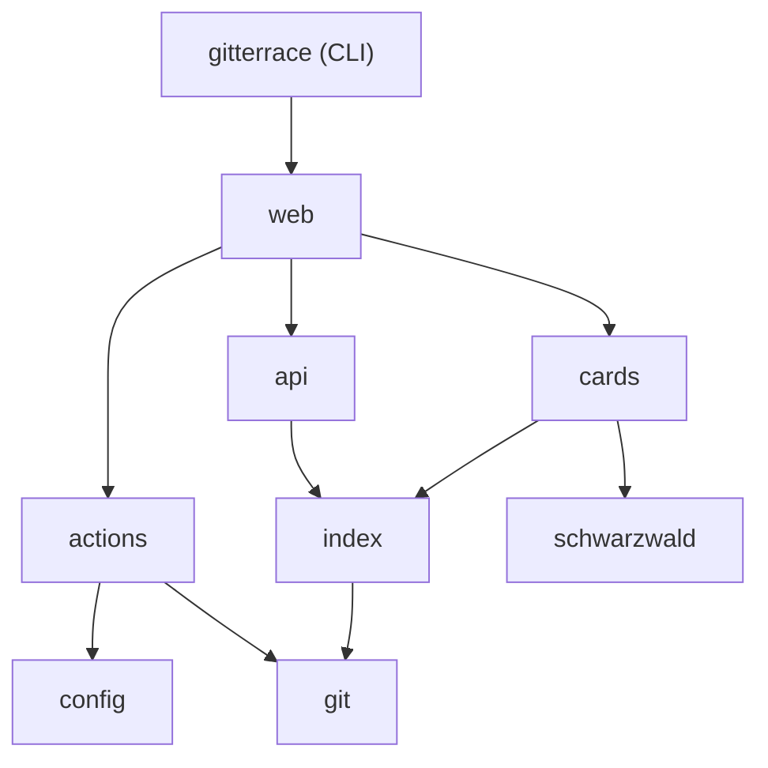

# Architecture

<!-- BEGIN GENERATED: crates -->

<!-- END GENERATED: crates -->

Only `gitterrace-git` imports `gix`; nothing below `gitterrace-web` knows HTTP.

## Decisions

- **Read-only.** The only write is the cache. Every read takes a resolved commit id, so a
  commit landing mid-request cannot tear a page. The uncommitted view is the one exception and
  tolerates files vanishing.
- **Browsing never waits on the cache.** Insights show progress until it is ready.
- **One guard** (`gitterrace-web/src/guard.rs`) in front of everything: loopback Host, no
  cross-site requests, CSP with hashed inline script (a test fails when a template script
  changes without its hash).
- **Live.** A watcher fingerprints each repository and pushes changes over `/events`.
  `config.toml` and `actions.toml` reload when they change.
- **Several repos** share one port under `/r/{name}/`; names resolve only through the table
  built at startup, never as a path.

## Cache (`.git/gitterrace/`)

<!-- BEGIN GENERATED: cache -->
| File | Holds |
| --- | --- |
| `VERSION` | The cache format. A mismatch deletes the cache and rebuilds it. The format is never migrated. |
| `commits.jsonl` | One record per commit, appended as the history is walked. Unreachable records are ignored, so rewritten history needs no cleanup, and a torn last line is dropped. |
| `lines.json` | Line counts per blob id for the language chart. A blob never changes, so the counts never go stale. |

The format version is `2`.

<!-- END GENERATED: cache -->

Disposable: deleting the folder only costs a rebuild. Bump the format version instead of
migrating.

## Routes

<!-- BEGIN GENERATED: routes -->
| Route | Shows |
| --- | --- |
| `/` | README, last commit, file list, key numbers |
| `/tree/{rev}/{path}` | Directory listing |
| `/blob/{rev}/{path}` | File with highlighting; large files load in chunks |
| `/raw/{rev}/{path}` | The bytes; over `limits.raw_mb` is refused |
| `/blame/{rev}/{path}` | Line authorship |
| `/log/{rev}` | Commits, filterable by author |
| `/history/{path}` | One file's commits with lines changed and renames |
| `/commit/{id}`, `/diff/{rev}/{index}` | A commit's diff, large files fold and load on demand |
| `/compare?base=&head=` | What changed between two revisions |
| `/refs`, `/tag/{name}` | Branches with divergence, tags with annotations |
| `/worktrees`, `/stashes` | Linked worktrees and stashes |
| `/worktree` | Uncommitted changes, read-only |
| `/search` | Code and commit search |
| `/stats`, `/stats/{page}` | Insights on the shared filter and period. `?rev=` follows any ref |
| `/badges/{name}`, `/cards/wrapped/{year}` | SVG badges and the year card |
| `/events` | Server-sent events: the page refreshes when the repository changes |
| `/api/files/{rev}`, `/api/refs`, `/api/last/{rev}/{path}`, `/api/progress` | Fragments the pages fetch (file finder, ref switcher, last commits, index progress) |
| `/api/v1/...` | JSON API, see [api.md](api.md) |
| `/go/{repo-id}/{sha}/{path}` | Permalink: finds the served repository by id and redirects |
| `/r/{name}/...` | Everything above for one repository, under several |
| `/api/repos` | The repository list the switcher reads |

<!-- END GENERATED: routes -->
