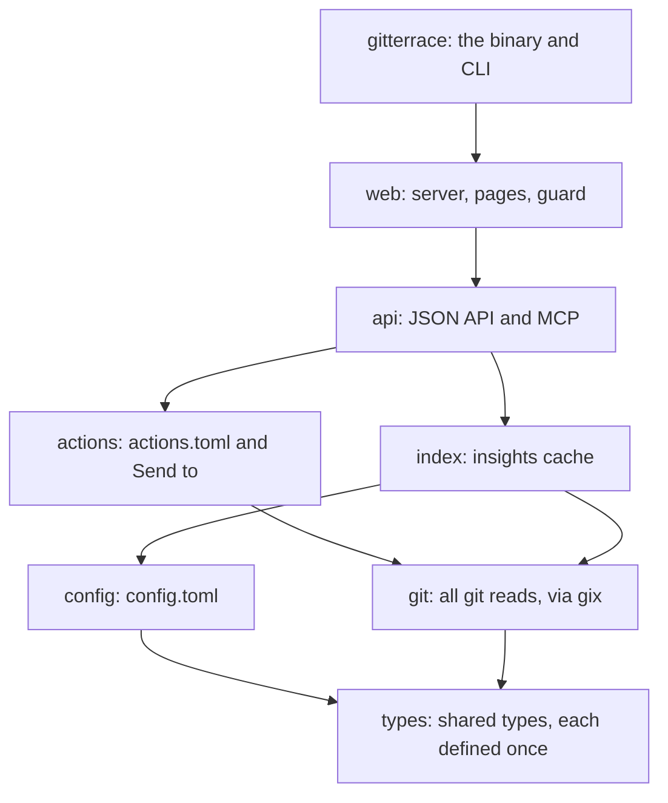

# Architecture

<!-- BEGIN GENERATED: crates -->

<!-- END GENERATED: crates -->

Each box is a crate the binary ships, and an arrow means "uses". An arrow
already implied by a longer path is left out, so `web` and `api` use `config`
too, though only `actions` points at it. `config` reads `config.toml` and knows
nothing else. `testkit` is not drawn, since only tests use it. `schwarzwald` is
the vendored theme.

## Decisions

- **The theme is a snapshot, not a design.** Colors, type, space and motion come
  only from `shared/schwarzwald/`, replaced as a whole, never edited.
  `scripts/theme-gen.py` writes the block in `tokens.css`. `make theme` fails on
  drift. Components use the role aliases, never a raw color, and charts are
  server-rendered SVG colored by class.
- **Read-only, pinned.** Every read takes a resolved commit id, so a commit
  landing mid-request cannot tear a page. Only the uncommitted view reads the
  worktree.
- **Browsing never waits on the cache**, and insights show progress.
- **One guard** (`gitterrace-web/src/guard.rs`): loopback Host, no cross-site
  requests, hashed inline script CSP.
- **Live.** A watcher pushes changes over `/events`, and config files reload on
  change. A repository that joins the server is announced the same way, so open
  pages show it in the switcher without a reload. Changes come from the OS's
  file events: a few watches on the git folder (HEAD, refs, `packed-refs`, the
  index) at all times, and the working tree while a tab shows it. Each event
  triggers a cheap check of what moved, and a burst is one check. A new commit
  or an edit usually shows within about a second. On a heavily loaded Mac the OS
  can drop a file change silently, and then it shows within `watch.rescan_secs`
  (30 by default), the setting to lower for a tighter bound. With no tab open
  nothing wakes more often than that. Where file events are unavailable (the
  watch limit, some network volumes) the server checks once a second instead.
- **Features switch off at the route.** Each `[features]` switch owns its routes
  (`gitterrace-web/src/features.rs`), and one gate answers a route of an off
  feature with the 404 of an unknown page. Pages ask the same table, so an off
  feature leaves no link or menu entry behind. Off always wins: the file narrows
  what public mode and the loopback checks allow, never widens it.
- **Markdown renders as the hosts do.** Heading anchors are the plain slugs most
  Markdown hosts make (`#getting-started`), so links written for elsewhere land.
  Only an id the page itself uses gets a prefix. Front matter shows as a table
  (`features.front_matter_enabled`), and a long document gets an "On this page"
  outline from its headings.
- **Dates read relative, the full date is a hover away** (`display.dates`).
- **Send to opens a URL in your browser.** The server never calls the
  destination, so there is nothing to authenticate and nothing written
  ([how Send to works](actions.md)).
- **Every repo under `/r/{name}/`**, also when it is the only one, resolved only
  through the repository table. `/` forwards to a lone repository and lists
  several. A link never moves when another repository joins.
  `/go/{repo-id}/{sha}` is the permalink and outlives names.
- **A name is assigned once.** It is the folder name made URL-safe and
  lowercase. A folder whose name another folder already holds gets `-` and six
  hex digits of its path. The first to arrive keeps the plain name. The name is
  kept in `repos.json` in the state folder, so a restart in any order serves
  each repository where it was. Without a state folder the same rule runs
  against the table alone.
- **A running server grows, it is never replaced.** Every server keeps a
  repository table and serves added ones under `/r/{name}/` beside the rest.
  `git terrace open` adds a repository the server lacks through `POST /_repos`
  instead of starting a second server, and so does a second `git terrace` on an
  address a gitterrace server already holds: it hands over its repositories and
  exits 0. Before it sends a path it asks `GET /_repos?nonce=N`, and the server
  must answer the SHA-256 of its secret and that nonce. A listener that cannot,
  or a missing secret, counts as foreign: `open` starts its own server and
  `serve` binds as usual. A second `serve` opens every root before it adds any.
  Once adding starts, a refused add is an error. It never falls through to a
  bind on the held address. `--public` never joins. That route makes the server
  read a path it was not started with, so a browser can never reach it: it
  exists only on a loopback bind, it refuses any `Origin` or `Sec-Fetch-Site`,
  and it needs a per-process secret the server writes 0600 into the state
  folder. The path must be canonical and a repository's top folder.
  `git terrace remove` sends `DELETE /_repos` through the same gate: its URLs
  answer 404, its refresher and warm-up stop, open switchers drop it, and its
  on-disk index and name stay for a fast re-add. The last repository stays, so
  `/` always has one (it forwards there when one is left). No page offers
  remove, since a page has no secret and may be seen by others. An added
  repository gets what a startup one does: its own refresher and warm-up,
  permalinks, actions and the switcher. A repository holding `actions.toml` is
  refused, as at start.
- **`gitterrace://` permalinks name what, not where.**
  `gitterrace://<repo-id>/<sha>/<path>` is the `/go` tuple without a host, so it
  works with no server running and on another machine. `git terrace open` finds
  the clone among repositories served before (recorded in
  `$XDG_STATE_HOME/gitterrace/repos.json`, else `~/.local/state/gitterrace`, on
  macOS too) and under `links.roots`, rechecks its id, then starts or reuses a
  server. A link is input from outside: one strict parser in
  `gitterrace-actions/src/link.rs`, the registry never stores anything from a
  link, and an unknown id never clones or fetches.

## Cache

<!-- BEGIN GENERATED: cache -->
| File | Holds |
| --- | --- |
| `VERSION` | The cache format. A mismatch deletes the cache and rebuilds it. The format is never migrated. |
| `lock` | Empty. Held locked by whichever process is extending the segment set, so two processes on one repository take turns instead of building on one manifest. |
| `owner` | Only in a cache outside the repository: the real path of the git dir it belongs to. Another path there wipes the cache, so a hash collision rebuilds. |
| `tip` | The commit id the segment files were last built for. Opening insights for that commit skips walking its history to check the files hold exactly it. |
| `lines.json` | Line counts per blob id for the language chart. A blob never changes, so the counts never go stale. |

The format version is `8`.

<!-- END GENERATED: cache -->

Disposable: bump the format version instead of migrating.

The cache lives in `.git/gitterrace/` and is used there whenever that folder can
be written. When it cannot (a read-only mount, a repository of another user),
it goes to `<dir>/<hash>`, where `<dir>` is the folder in
`GITTERRACE_INDEX_FALLBACK` and the hash is of the real path of the git dir.
Without that variable such a repository has no cache. The Docker
image sets it to `/cache/index`.

### How the index is stored

The index is a set of immutable files. A segment holds a run of commits as
columns, file rows, path and author postings, and the aggregates that insights
pages read (author by day, path by author, month by path). A string file beside
it holds the paths, identities and labels that segment introduced. Nothing is
ever written to again once it is renamed into place.

`MANIFEST` is the only entry point. It names every live file with its length and
CRC32, and is swapped by rename, so a crash leaves the previous complete set.
Files it does not name are ignored and swept. A new HEAD adds one small segment,
and many segments are merged back into one.

Pages never load the history. A reader opens a segment, checks its footer, and
reads blocks with `pread`. Each block is checked against its CRC before any
field in it is parsed, and every length and offset is bounded, since `.git/` may
belong to someone else.

One rule covers damage: if the cache cannot be read, it is deleted and rebuilt.
That means a different format version, a torn manifest, a bad CRC, or a changed
shallow set. It is never partly served. The page shows indexing until the
rebuild is done. A cache written by a newer build is left alone and the page
says so.

### How commit search reads the index

Commit search matches a regex on each commit's full message plus its author as
`name <email>` after the mailmap, newest first. Walking git for that decodes
every commit, so a miss on a large history takes seconds. The message column
keeps what the search needs in the index instead.

What it holds: one item per commit, in the order of the segments. An item is
the message as the walk decodes it, the author as written, the committer time
and the parents. The mailmap is not baked in: the tip's `.mailmap` is applied to
each distinct author once per search, so editing it never rebuilds anything.
Items are packed into blocks of about 64 KiB, each compressed with zstd. The
blocks live in `msg-<gen>-<n>.gts` files of the same container format as the
segments. `MANIFEST` names each file with its length and CRC32, like every other
file, so the column is part of the one live set.

How a search runs: the blocks are read with `pread`, checked against their CRC,
inflated on up to 8 threads, and the regex runs on each item. The newest-first
order is git's own walk replayed over the stored times and parents, ties
included, so the list is the one the walk gives. It stops at
`limits.search_commits` and says when more matched. Only then does the search
open commit objects, one per listed row, for its subject and dates. A miss lists
no rows, so it reads no commit object at all. An item over 512 KiB (a generated
message) is stored without its text and checked from git.

How it stays current: the refresh task that updates the index after HEAD moves
also adds the column's new commits, under the same writer lock, as one more
file per update. When the segments are merged, the column is rewritten in the
new order beside them. A column that does not reach the searched commit (being
built, or a rev that is not HEAD) is not used, and that search walks git.

Damage: the column follows the rule above. A bad CRC, a file cut short, a block
that does not inflate, or another format version means the cache is deleted and
rebuilt. It never yields a wrong or partial list. The request that met the
damage logs it once and walks git for its answer, and insights pages show
indexing until the rebuild is done. With the setting off, the column is dropped
at the next update and search walks git as it always did.

The setting is `[index] has_messages`, on by default. On rust (345k commits) it
costs 31 MB of cache, 12% more, and 16 s to build the first time. A miss there
takes 68 ms instead of 3.1 s.

Why not a search library: Tantivy indexes words or trigrams and cannot run our
regex over a whole message. Our code would still pick candidates, run the regex
and order the hits, which is most of the work. Measured on rust, its index was
113 MB against the column's 31 MB, and a wide hit (`fix`) took 670 ms against
the walk's 22 ms, because every candidate is checked before the order is known.
A regex without a literal of three characters still scanned everything (3.1 s).
It added 3.2 MB to the binary and 59 crates. It panicked on a truncated file
instead of returning an error, and it reads through mmap, which breaks the rule
that serving reads bounded blocks with `pread`.

SQLite full-text search (FTS5 with a trigram index) answers faster: on rust a
miss took under 1 ms, a regex hit 19 ms and a wide hit on `fix` 77 ms, with our
regex checking each candidate. A regex without plain text still scanned
everything (265 ms). Its index was 362 MB against the column's 31 MB, and the
first build took 33 s against 3.8 s. It added 1.7 MB to the binary and 9 crates,
among them SQLite's C source. It keeps no checksums: of 6 damage cases 5 gave an
error, and garbage in the middle of the file went unseen, since the query never
read the 16 damaged pages. The column stays because it is under a tenth of the
size, builds about nine times faster, needs no C database engine (its only C is
zstd), and never serves from a damaged file without noticing.

### Memory

While serving, resident memory is a budget of `resources.cache_mb` (default 32
MB) for caches and rendered pages, plus 16 MB of margin. It does not grow with
the history. A page folds the blocks of its time range through a small buffer
into a result sized by the answer. The OS file cache is not counted. The peak
during an index build is higher and is accepted.

After 30 s without a request the server drops every cache but the rendered
pages, and the allocator hands freed pages back to the OS at once. Builds from
this repository run jemalloc with one arena (`.cargo/config.toml`), so an idle
server returns to about the footprint it started with. The
full format is in the store design,
[store.md on GitHub](../crates/gitterrace-index/src/seg/store.md).

### The InsightsSource seam

Pages read history through the `InsightsSource` trait in
`gitterrace-index/src/feed/`. It gives commit columns for a range, file rows for
chosen commits, the aggregates, postings and strings, all as streams.
`feed/segments.rs` serves it from the files. `feed/memory.rs` serves it from
records in memory and is the oracle that tests compare the segments against. A
page does not know which one it has.

## Routes

Every row from `/` to `/api/v1` is per repository and lives under `/r/{name}`,
also when one repository is served. The rest are the server's own and never take
the prefix.

<!-- BEGIN GENERATED: routes -->
| Route | Shows |
| --- | --- |
| `/` | README, last commit, file list, key numbers. The server's own `/` forwards to the one repository, or lists several |
| `/tree`, `/blob`, `/raw`, `/blame` `/{rev}/{path}` | Files: listing, highlighted view (large files load in chunks), bytes, authorship |
| `/log/{rev}`, `/history/{path}`, `/compare` | Commits, one file's history, two revisions |
| `/commit/{id}`, `/diff/{rev}/{index}` | A commit's diff, large files fold and load on demand |
| `/refs`, `/tag/{name}`, `/worktrees`, `/stashes`, `/worktree`, `/worktree/diff/{path}`, `/worktree/raw/{path}` | Git state: branches, tags, linked worktrees, stashes, uncommitted changes, their folded files and changed images |
| `/search` | Code and commit search |
| `/stats`, `/stats/{page}` | Insights on the shared filter and period: activity (with commit types and code frequency), contributors, hotspots (with patterns), languages, ownership. `/stats/types`, `/stats/frequency` and `/stats/patterns` answer with a permanent redirect to their section, query kept, and `/insights` to `/stats`. `?rev=` follows any ref |
| `/events`, `/api/{files,refs,last,progress}` | Live updates and the fragments pages fetch |
| `/api/v1/...` | JSON API, see [api.md](api.md) |
| `/go/{repo-id}/{sha}/{path}` | Permalink: finds the served repository by id |
| `/_send/targets` | Send to targets as JSON template parts, filled in by the page |
| `/r/{name}/...`, `/api/repos` | The prefix of every per-repository row above, also when one is served; and the server-wide list the switcher reads |
| `/_dirty` | The repositories with uncommitted work, as JSON the home page fetches to fill its chips after the rows render |
| `POST /_repos`, `DELETE /_repos`, `GET /_repos?nonce=N` | Adds a repository to the running server for `git terrace open`, or takes one off for `git terrace remove`: loopback, no browser, secret from a 0600 file. The GET proves the secret by hashing it with the nonce |
| `/_settings`, `/_settings/file`, `POST /_settings/check` | The settings page: a form and a plain editor for `config.toml` and `actions.toml`, read, checked and saved on local servers only, same-origin with the page token, never a path from the request |

<!-- END GENERATED: routes -->

## Syntax highlighting

Code, diffs, blame and fenced blocks in markdown are highlighted with the
grammars of [bat](https://github.com/sharkdp/bat) (through `two-face` and
`syntect`), compiled into the binary. A file is matched by name, then extension,
then its `#!` line. Text over `limits.highlight_kb` (default 256 KiB) shows
plain. These are the languages:

<!-- BEGIN GENERATED: languages -->
182 languages: ActionScript, Ada, Apache Conf, AppleScript, ARM Assembly,
AsciiDoc (Asciidoctor), ASP, Authorized Keys, AWK, Batch File, BibTeX, Bourne
Again Shell (bash), C, C#, C++, Cabal, CFML, Clojure, CMake, CMake C Header,
CMake C++ Header, CMakeCache, CoffeeScript, Command Help, CpuInfo, Crontab,
Crystal, CSS, D, Dart, debsources, Diff, Dockerfile, DotENV, Elixir, Elm, Email,
Erlang, F#, Fish, Fortran (Fixed Form), Fortran (Modern), Fortran Namelist,
fstab, GDScript (Godot Engine), Git Attributes, Git Commit, Git Config, Git
Ignore, Git Link, Git Log, Git Mailmap, Git Rebase Todo, GLSL, gnuplot, Go,
Gomod, Gosum, GraphQL, Graphviz (DOT), Groff/troff, Groovy, group, Haskell,
Highlight non-printables, Hosts File, HTML, HTML (ASP), HTML (EEx), HTML
(Erlang), HTML (Jinja2), HTML (Rails), HTML (Tcl), HTML (Twig), HTTP Request and
Response, Idris, INI, Java, Java Properties, Java Server Page (JSP), JavaScript,
JavaScript (Babel), JavaScript (Rails), Jinja2, JQ, JSON, jsonnet, Julia, Known
Hosts, Kotlin, LaTeX, Lean 4, Less, Lisp, Literate Haskell, LiveScript, LLVM,
log, Lua, Makefile, Manpage, Markdown, MATLAB, MediaWiki, MemInfo, NAnt Build
File, nginx, Nim, Ninja, Nix, NSIS, Objective-C, Objective-C++, OCaml, OCamllex,
OCamlyacc, Odin, orgmode, Pascal, passwd, Perl, PHP, PowerShell, Protocol
Buffer, Protocol Buffer (TEXT), Puppet, PureScript, Python, QML, R, Racket, Rd
(R Documentation), Rego, Regular Expression, Requirements.txt, resolv,
reStructuredText, Robot Framework, Ruby, Ruby Haml, Ruby on Rails, Ruby Slim,
Rust, Salt State (SLS), Sass, Scala, SCSS, Separated Values, SML, Solidity, SQL,
SQL (Rails), SSH Config, SSHD Config, Strace, Stylus, Svelte, Swift, syslog,
SystemVerilog, Tab Separated Values, Tcl, Terraform, TeX, Textile, Todo.txt,
TOML, TypeScript, TypeScriptReact, Typst, varlink, Verilog, VHDL, VimHelp, VimL,
Vue Component, Vyper, WGSL, x86_64 Assembly, XML, YAML, Zig.

<!-- END GENERATED: languages -->
