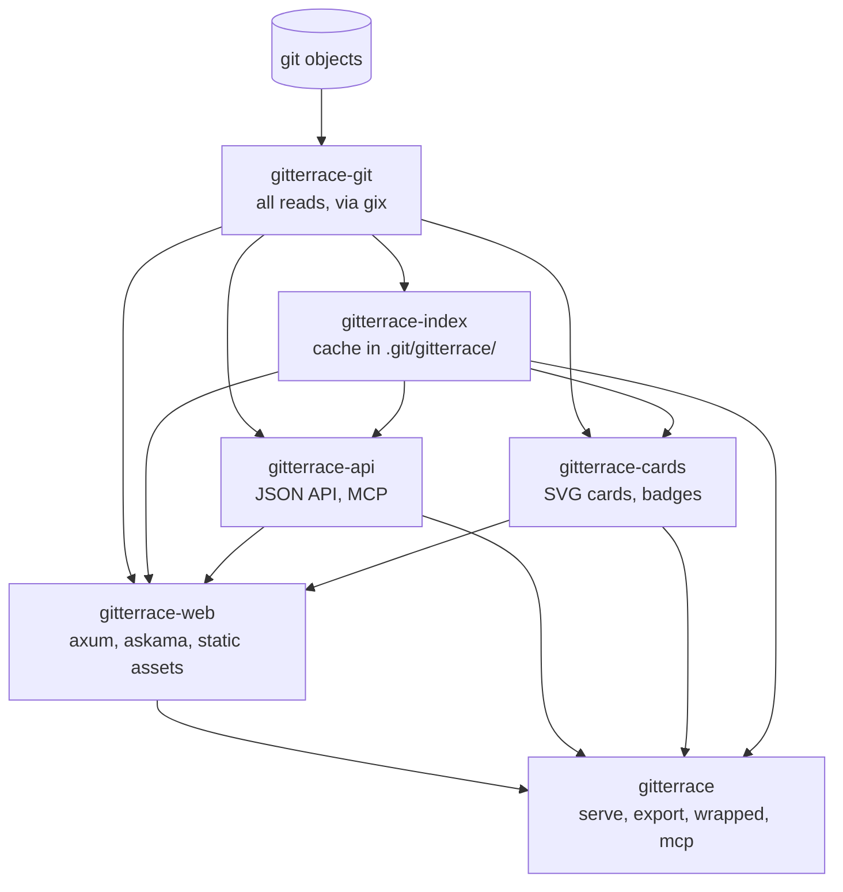

# Architecture

Every crate below `gitterrace-web` is HTTP-free, and only `gitterrace-git`
imports `gix`. Colours come from the vendored `schwarzwald` crate in
`theme/schwarzwald/rust` (see [design.md](design.md)).

## Serving

`git terrace [paths]` serves one repository at `/`, or several under
`/r/{name}/` with a repo index at `/`. A folder argument is searched two
levels deep for repositories, skipping `node_modules`, `target` and `.wt`. A
repository's router, index refresher and caches start on its first visit.
Names resolve only through the table built at startup, never as a path.

Every response passes one guard (`gitterrace-web/src/guard.rs`):

- **Host header:** loopback names only, plus the bound address when the bind
  is not loopback. This blocks DNS rebinding.
- **Cross-site requests:** a request with `Sec-Fetch-Site: cross-site` is
  refused.
- **Headers:** every response gets CORP `same-origin` and `nosniff`. HTML gets
  a CSP whose inline scripts are allowed by hash. A test fails when a template
  script changes without its hash.

Responses are gzip- or brotli-compressed, except fonts and images. Static CSS
and JS carry an `ETag`.

## Cache (`.git/gitterrace/`)

- `VERSION` holds the cache format (`FORMAT_VERSION` in
  `crates/gitterrace-index/src/store.rs`). A mismatch deletes and rebuilds;
  the format is never migrated.
- `commits.jsonl` holds one `CommitRecord` per line. `update` walks the
  history from HEAD, skips ids already stored (read from the line prefix,
  without a full parse) and appends the rest. Unreachable records are ignored,
  so rewritten history needs no cleanup. A torn last line is dropped.
- Records are parsed in parallel once per HEAD and shared by the pages, the
  API and MCP.
- Head line counts are cached in the same folder and kept in memory per HEAD.
- The index refresher checks HEAD every second.
- After each index generation, the unfiltered insights pages are rendered
  once in the background. Filtered views are memoized per tip and query.
- Browsing never waits on the cache. Insights pages show progress until it is
  ready.

## Pages

| Route | Shows |
| --- | --- |
| `/` | README, last commit, file list, key numbers |
| `/tree/{rev}/{path}`, `/blob/{rev}/{path}`, `/raw/{rev}/{path}` | Files; blobs over 2 MiB link to raw |
| `/blame/{rev}/{path}` | Line authorship, cached per commit and path |
| `/log/{rev}` | Commits, filterable by author |
| `/history/{path}` | One file's commits with author, lines changed and renames |
| `/commit/{id}`, `/diff/{rev}/{index}` | Diff; large files fold and load on demand |
| `/compare?base=&head=` | What changed between two revisions: commits, authors, files, lines |
| `/refs` | Branches and tags |
| `/search` | Code and commit search |
| `/worktree` | Uncommitted changes, read-only |
| `/stats`, `/stats/{files,types,languages,frequency,contributors,pulse,hotspots,ownership,patterns}` | Insights on the shared filter (type, scope, author, path, period) |
| `/badges/{name}`, `/cards/wrapped/{year}` | SVG badges and the year card |
| `/api/v1/...` | JSON API, see [api.md](api.md) |
