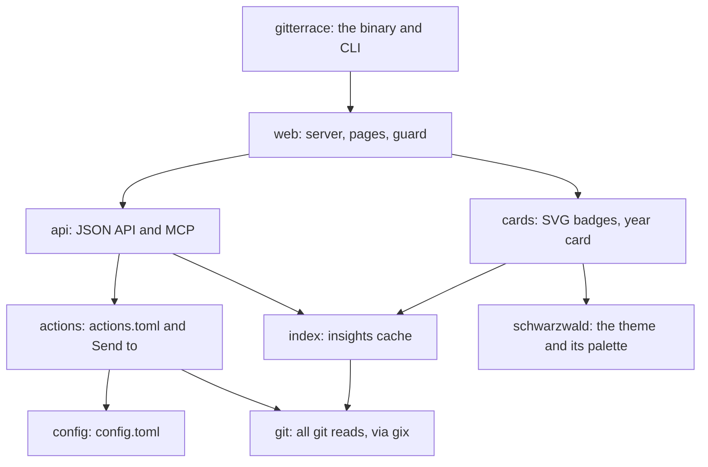

# Architecture

<!-- BEGIN GENERATED: crates -->

<!-- END GENERATED: crates -->

Each box is a crate. An arrow means "uses". `schwarzwald` is the vendored theme (colours, type,
tokens, see [design](design.md)); `cards` reads its palette, called Kandel, to colour the SVG
badges and the year card.

## Decisions

- **Read-only, pinned.** Every read takes a resolved commit id, so a commit landing
  mid-request cannot tear a page. Only the uncommitted view reads the worktree.
- **Browsing never waits on the cache**; insights show progress.
- **One guard** (`gitterrace-web/src/guard.rs`): loopback Host, no cross-site requests, hashed
  inline script CSP.
- **Live.** A watcher pushes changes over `/events`; config files reload on change.
- **Send to opens a URL in your browser.** The server never calls the destination, so there is
  nothing to authenticate and nothing written ([how Send to works](actions.md)).
- **Several repos** under `/r/{name}/`, resolved only through the startup table.

## Cache

<!-- BEGIN GENERATED: cache -->
| File | Holds |
| --- | --- |
| `VERSION` | The cache format. A mismatch deletes the cache and rebuilds it. The format is never migrated. |
| `commits.jsonl` | One record per commit, appended as the history is walked. Unreachable records are ignored, so rewritten history needs no cleanup, and a torn last line is dropped. |
| `lines.json` | Line counts per blob id for the language chart. A blob never changes, so the counts never go stale. |

The format version is `2`.

<!-- END GENERATED: cache -->

Disposable: bump the format version instead of migrating.

## Routes

<!-- BEGIN GENERATED: routes -->
| Route | Shows |
| --- | --- |
| `/` | README, last commit, file list, key numbers |
| `/tree`, `/blob`, `/raw`, `/blame` `/{rev}/{path}` | Files: listing, highlighted view (large files load in chunks), bytes, authorship |
| `/log/{rev}`, `/history/{path}`, `/compare` | Commits, one file's history, two revisions |
| `/commit/{id}`, `/diff/{rev}/{index}` | A commit's diff, large files fold and load on demand |
| `/refs`, `/tag/{name}`, `/worktrees`, `/stashes`, `/worktree` | Git state: branches, tags, linked worktrees, stashes, uncommitted changes |
| `/search` | Code and commit search |
| `/stats`, `/stats/{page}` | Insights on the shared filter and period. `?rev=` follows any ref |
| `/badges/{name}`, `/cards/wrapped/{year}` | SVG badges and the year card |
| `/events`, `/api/{files,refs,last,progress}` | Live updates and the fragments pages fetch |
| `/api/v1/...` | JSON API, see [api.md](api.md) |
| `/go/{repo-id}/{sha}/{path}` | Permalink: finds the served repository by id |
| `/r/{name}/...`, `/api/repos` | Everything above under several repositories; the list the switcher reads |

<!-- END GENERATED: routes -->
