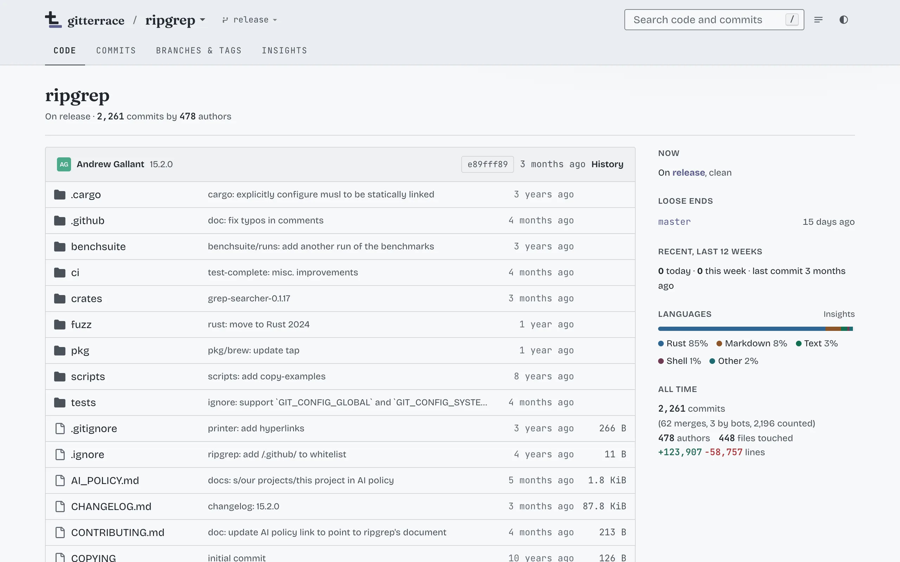
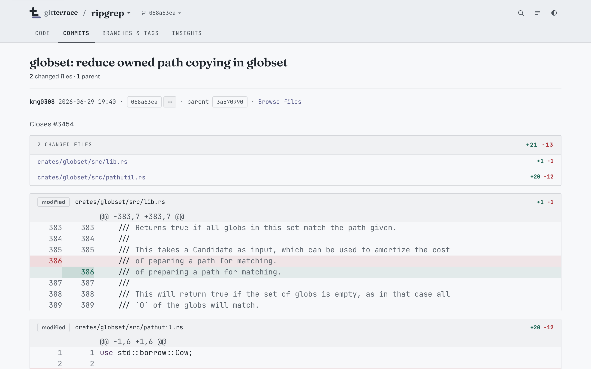
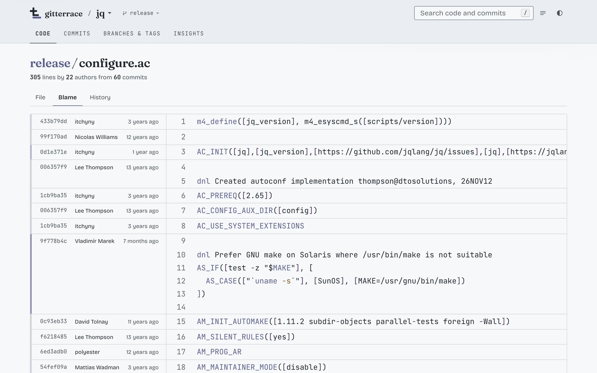
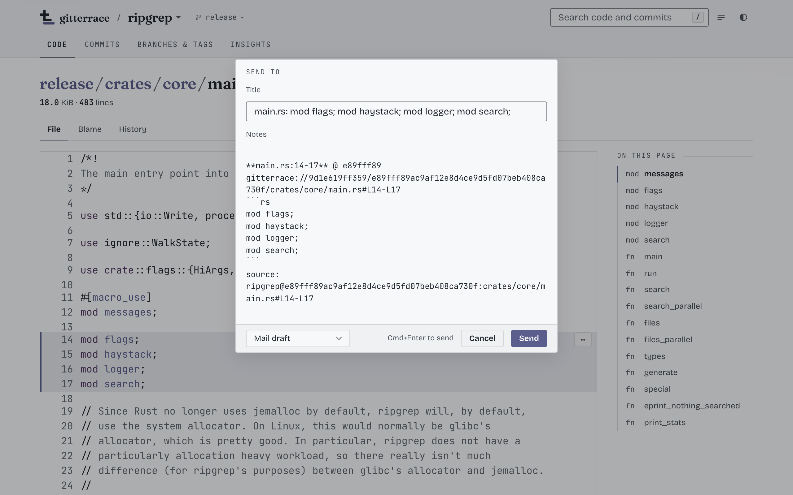
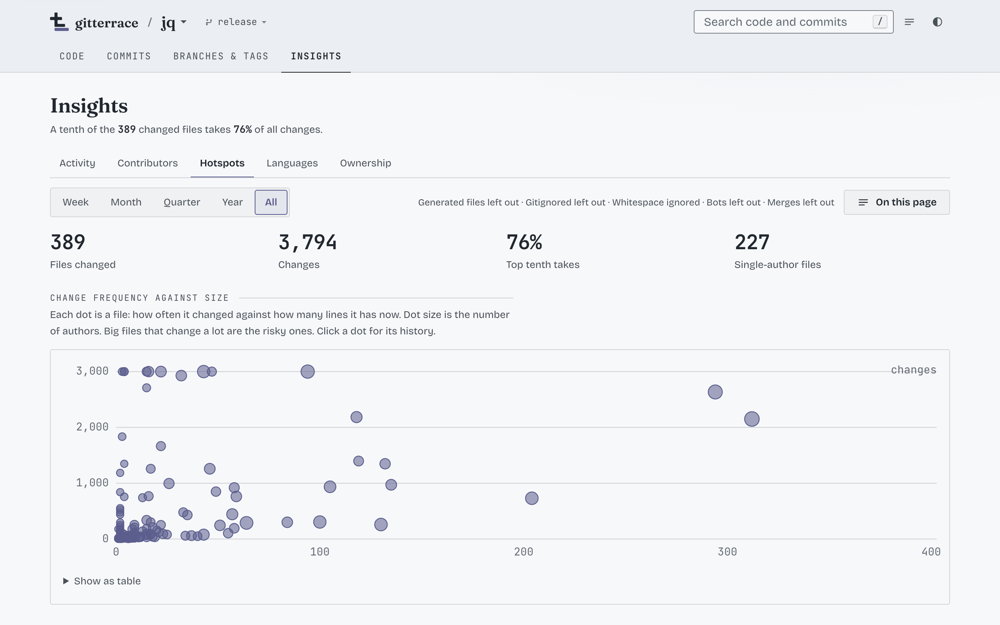
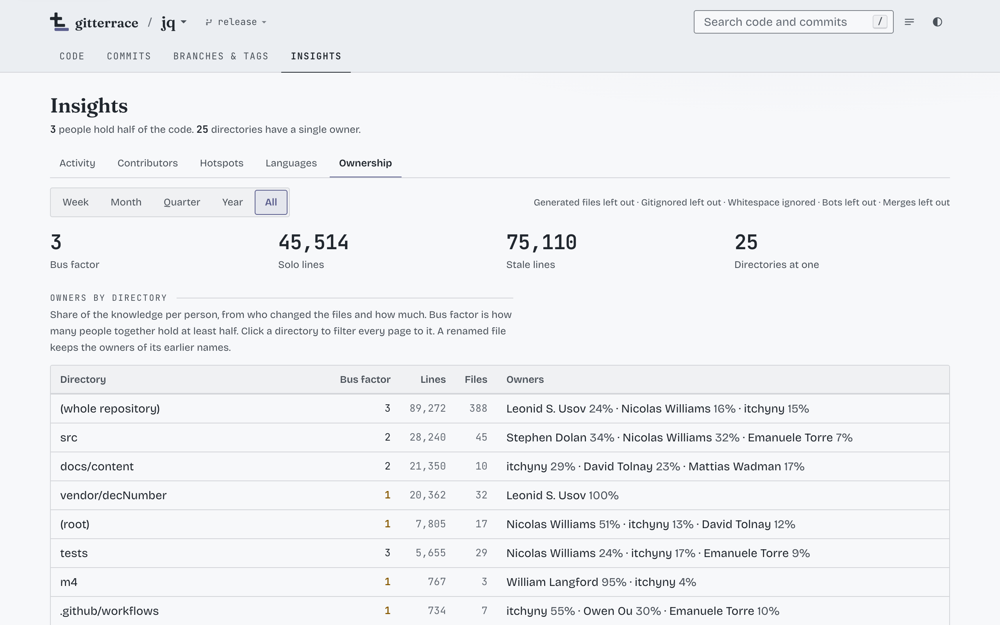

# Screenshots

Generated by `make docs-gen`, taken by `make site-shots`.

## Browse

Browse: the repository page with README, last commit, file list and key numbers.

<picture>
<source media="(prefers-color-scheme: dark)" srcset="overview-dark.webp">

</picture>

Shows [ripgrep 15.2.0](https://github.com/BurntSushi/ripgrep/tree/15.2.0).

## Commit

Commit: the message, the changed files and a highlighted diff.

<picture>
<source media="(prefers-color-scheme: dark)" srcset="commit-dark.webp">

</picture>

Shows [ripgrep 15.2.0](https://github.com/BurntSushi/ripgrep/tree/15.2.0).

## Blame

Blame: who last changed each line, with the commit and its age beside the code.

<picture>
<source media="(prefers-color-scheme: dark)" srcset="blame-dark.webp">

</picture>

Shows [jq jq-1.8.2](https://github.com/jqlang/jq/tree/jq-1.8.2).

## Send to

Send to: marked lines with their context, ready for mail, an issue, a merge
request or your task list.

<picture>
<source media="(prefers-color-scheme: dark)" srcset="send-dark.webp">

</picture>

Shows [ripgrep 15.2.0](https://github.com/BurntSushi/ripgrep/tree/15.2.0).

## Hotspots

Hotspots: the files that change most, against how many people touch them.

<picture>
<source media="(prefers-color-scheme: dark)" srcset="insights-dark.webp">

</picture>

Shows [jq jq-1.8.2](https://github.com/jqlang/jq/tree/jq-1.8.2).

## Ownership

Ownership: bus factor, solo and stale lines, and who holds each directory.

<picture>
<source media="(prefers-color-scheme: dark)" srcset="ownership-dark.webp">

</picture>

Shows [jq jq-1.8.2](https://github.com/jqlang/jq/tree/jq-1.8.2).

[The screenshots](./) show the open source projects
[jq](https://github.com/jqlang/jq/tree/jq-1.8.2) and
[ripgrep](https://github.com/BurntSushi/ripgrep/tree/15.2.0), used under their
MIT licenses. They are not affiliated with gitterrace. Thanks to their authors
for great tools.
