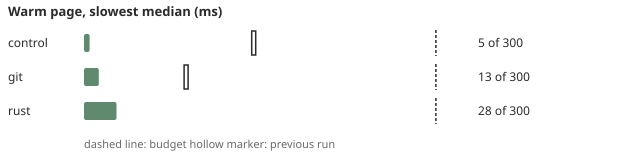
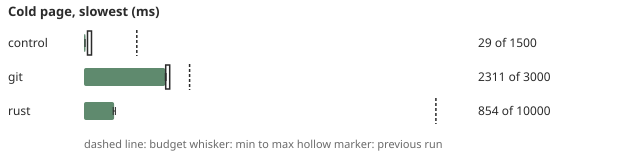
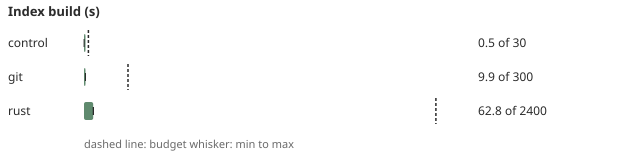
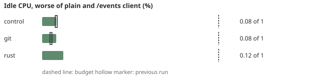
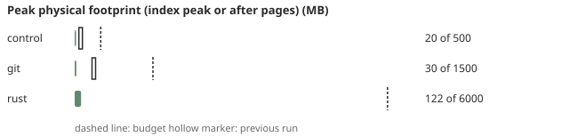
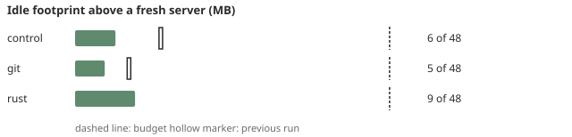
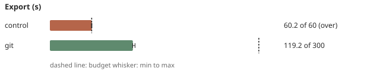

# Benchmark run 2026-11-17-apple-m1-max

Run 2026-11-17 on Apple M1 Max, 10 cores, 64 GB RAM, 4.0 TB SSD disk, macOS
26.6.2 (arm64). gitterrace v0.1.1-ddae313, git version 2.54.0 (Apple Git-157).
Measured on a quiet machine.

- **linux:** not measured on a quiet machine (other processes used 5 or more
  cores during export), so its numbers are withheld.

Numbers: [`../2026-11-17-apple-m1-max.json`](../2026-11-17-apple-m1-max.json).
Method: [docs/benchmarks.md](../../../../docs/benchmarks.md).

<picture>
<source media="(prefers-color-scheme: dark)" srcset="./page_warm_ms-dark.svg">

</picture>

<picture>
<source media="(prefers-color-scheme: dark)" srcset="./page_cold_ms-dark.svg">

</picture>

<picture>
<source media="(prefers-color-scheme: dark)" srcset="./index_secs-dark.svg">

</picture>

<picture>
<source media="(prefers-color-scheme: dark)" srcset="./idle_cpu_pct-dark.svg">

</picture>

<picture>
<source media="(prefers-color-scheme: dark)" srcset="./rss_mb-dark.svg">

</picture>

<picture>
<source media="(prefers-color-scheme: dark)" srcset="./footprint_idle_mb-dark.svg">

</picture>

<picture>
<source media="(prefers-color-scheme: dark)" srcset="./export_secs-dark.svg">

</picture>
