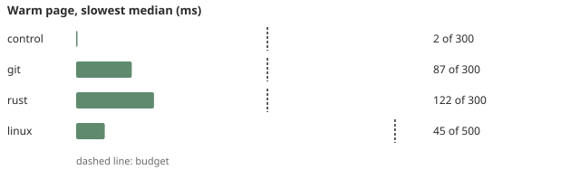
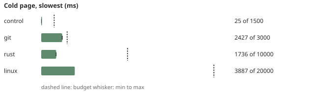
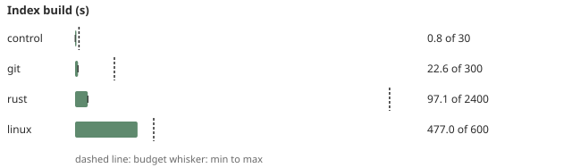
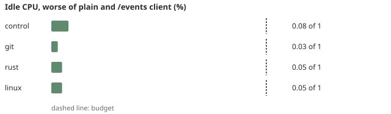
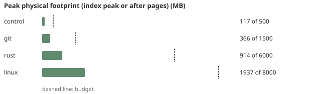
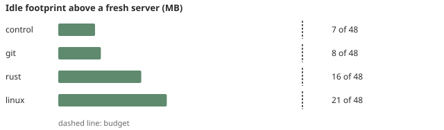

# Benchmark results

Each benchmark run (`make bench`, with `LARGE=1` to add the largest repository)
writes one `<date>-<machine>.json` here plus a folder with its charts, and
`scripts/bench/bench-report.py` regenerates this page. The method, corpus and
budgets are in [docs/benchmarks.md](../../../docs/benchmarks.md).

| Date | Machine | gitterrace | Repos | Files |
| --- | --- | --- | --- | --- |
| 2026-11-12 | Apple M1 Max, 10 cores, 64 GB RAM, macOS 26.6.2 | gitterrace v0.1.0-548f044 | control, git, rust, linux | [json](2026-11-12-apple-m1-max.json), [charts](2026-11-12-apple-m1-max/) |

## Newest run, 2026-11-12

Run 2026-11-12 on Apple M1 Max, 10 cores, 64 GB RAM, 4.0 TB SSD disk, macOS
26.6.2 (arm64). gitterrace v0.1.0-548f044, git version 2.54.0 (Apple Git-157).
Measured on a quiet machine.

| Repo | Metric | Value | Budget | Status |
| --- | --- | --- | --- | --- |
| control | index build | 0.8 s (0.6 to 0.8) | 30 s | pass |
| control | warm page | 2 ms | 300 ms | pass |
| control | cold page | 25 ms (25 to 25) | 1500 ms | pass |
| control | peak memory | 117 MB | 500 MB | pass |
| control | export | 34.4 s (33.5 to 34.7) | 60 s | pass |
| git | index build | 22.6 s (22.1 to 23.2) | 300 s | pass |
| git | warm page | 87 ms | 300 ms | pass |
| git | cold page | 2427 ms (2409 to 2448) | 3000 ms | pass |
| git | peak memory | 366 MB | 1500 MB | pass |
| git | export | 55.1 s (53.1 to 56.8) | 300 s | pass |
| rust | index build | 97.1 s (96.9 to 98.0) | 2400 s | pass |
| rust | warm page | 122 ms | 300 ms | pass |
| rust | cold page | 1736 ms (1720 to 1737) | 10000 ms | pass |
| rust | peak memory | 914 MB | 6000 MB | pass |
| linux | index build | 477.0 s (477.0 to 477.0) | 600 s | pass |
| linux | warm page | 45 ms | 500 ms | pass |
| linux | cold page | 3887 ms (3887 to 3887) | 20000 ms | pass |
| linux | peak memory | 1937 MB | 8000 MB | pass |

5 warm runs per page, 60 s idle windows.

### control

small repository, measured at the run of 2026-11-12. All 7 metrics are within
budget. Against budget: export 34.4 s (33.5 to 34.7) of 60 s, idle footprint
above a fresh server 7 MB of 48 MB, idle CPU 0.08 % of 1 %, index build 0.8 s
(0.6 to 0.8) of 30 s, cold page 25 ms (25 to 25) of 1500 ms, warm page 2 ms of
300 ms, peak memory 117 MB of 500 MB.

Idle CPU is the larger of two windows: 0.03 % with no client and 0.08 % with one
/events client.

### git

medium repository, measured at `50fe5cc63f`. All 7 metrics are within budget.
Against budget: export 55.1 s (53.1 to 56.8) of 300 s, idle footprint above a
fresh server 8 MB of 48 MB, idle CPU 0.03 % of 1 %, index build 22.6 s (22.1 to
23.2) of 300 s, cold page 2427 ms (2409 to 2448) of 3000 ms, warm page 87 ms of
300 ms, peak memory 366 MB of 1500 MB.

Idle CPU is the larger of two windows: 0.03 % with no client and 0.02 % with one
/events client.

### rust

large repository, measured at `f90a2d27c2`. All 6 metrics are within budget.
Against budget: idle footprint above a fresh server 16 MB of 48 MB, idle CPU
0.05 % of 1 %, index build 97.1 s (96.9 to 98.0) of 2400 s, cold page 1736 ms
(1720 to 1737) of 10000 ms, warm page 122 ms of 300 ms, peak memory 914 MB of
6000 MB.

Idle CPU is the larger of two windows: 0.05 % with no client and 0.02 % with one
/events client.

### linux

huge repository, measured at `cbbddb6b08`. All 6 metrics are within budget.
Against budget: idle footprint above a fresh server 21 MB of 48 MB, idle CPU
0.05 % of 1 %, index build 477.0 s (477.0 to 477.0) of 600 s, cold page 3887 ms
(3887 to 3887) of 20000 ms, warm page 45 ms of 500 ms, peak memory 1937 MB of
8000 MB.

Idle CPU is the larger of two windows: 0.05 % with no client and 0.02 % with one
/events client.

| Repo | Class | Measured at | Index | Peak RSS | Cache | RSS after pages | Idle footprint, total | Idle CPU | Idle CPU with /events | Export | Cold samples |
| --- | --- | --- | --- | --- | --- | --- | --- | --- | --- | --- | --- |
| control | small | the run of 2026-11-12 | 0.8 s | 134 MB | 1 MB | 43 MB | 12 MB | 0.03% | 0.08% | 34.4 s, 110 MB | median of 3 |
| git | medium | `50fe5cc63f` | 22.6 s | 647 MB | 45 MB | 358 MB | 13 MB | 0.03% | 0.02% | 55.1 s, 218 MB | median of 3 |
| rust | large | `f90a2d27c2` | 97.1 s | 1951 MB | 295 MB | 1198 MB | 21 MB | 0.05% | 0.02% | 928.6 s, 1 run, 1699 MB | median of 3 |
| linux | huge | `cbbddb6b08` | 477.0 s | 8176 MB | 1469 MB | 6596 MB | 26 MB | 0.05% | 0.02% | 1277.4 s, 1 run, 6154 MB | 1 sample |

control is a working checkout, so with a tab open the server also checks it for
uncommitted changes every second. git, rust, linux are bare clones with no
working tree, so they have nothing to check and idle lower.

<picture>
<source media="(prefers-color-scheme: dark)" srcset="2026-11-12-apple-m1-max/page_warm_ms-dark.svg">

</picture>

<picture>
<source media="(prefers-color-scheme: dark)" srcset="2026-11-12-apple-m1-max/page_cold_ms-dark.svg">

</picture>

<picture>
<source media="(prefers-color-scheme: dark)" srcset="2026-11-12-apple-m1-max/index_secs-dark.svg">

</picture>

<picture>
<source media="(prefers-color-scheme: dark)" srcset="2026-11-12-apple-m1-max/idle_cpu_pct-dark.svg">

</picture>

<picture>
<source media="(prefers-color-scheme: dark)" srcset="2026-11-12-apple-m1-max/rss_mb-dark.svg">

</picture>

<picture>
<source media="(prefers-color-scheme: dark)" srcset="2026-11-12-apple-m1-max/footprint_idle_mb-dark.svg">

</picture>

<picture>
<source media="(prefers-color-scheme: dark)" srcset="2026-11-12-apple-m1-max/export_secs-dark.svg">

</picture>

control: every page

Probes: `docs/screenshots/send-light.webp` (largest text file), commit the run
of 2026-11-12.

| Page | Cold | Warm TTFB | Warm full (median) | min | max | Bytes |
| --- | --- | --- | --- | --- | --- | --- |
| blame-long-history | 2 ms | 1 ms | 1 ms | 0 ms | 1 ms | 8086 |
| blob-largest | 1 ms | 1 ms | 1 ms | 1 ms | 1 ms | 8221 |
| commit-largest | 5 ms | 1 ms | 1 ms | 1 ms | 1 ms | 11893 |
| diff-fragment | 2 ms | 2 ms | 2 ms | 1 ms | 2 ms | 3142 |
| log | 2 ms | 1 ms | 1 ms | 1 ms | 1 ms | 39948 |
| overview | 14 ms | 2 ms | 2 ms | 2 ms | 2 ms | 27280 |
| refs | 1 ms | 1 ms | 1 ms | 1 ms | 2 ms | 9935 |
| search | 25 ms | 1 ms | 1 ms | 1 ms | 1 ms | 332468 |
| stats-overview | 1 ms | 1 ms | 1 ms | 0 ms | 1 ms | 108469 |
| stats/contributors | 0 ms | 0 ms | 0 ms | 0 ms | 0 ms | 11515 |
| stats/hotspots | 1 ms | 0 ms | 0 ms | 0 ms | 1 ms | 246568 |
| stats/languages | 1 ms | 0 ms | 1 ms | 1 ms | 1 ms | 395988 |
| stats/ownership | 0 ms | 0 ms | 0 ms | 0 ms | 0 ms | 17890 |
| tree-deep | 1 ms | 1 ms | 1 ms | 1 ms | 1 ms | 9216 |
| tree-root | 2 ms | 1 ms | 1 ms | 1 ms | 1 ms | 24000 |

| Budget | Value | Limit | Status |
| --- | --- | --- | --- |
| export_secs | 34.4 | 60 | pass |
| footprint_idle_mb | 7.2 | 48 | pass |
| idle_cpu_pct | 0.1 | 1 | pass |
| index_secs | 0.8 | 30 | pass |
| page_cold_ms | 25.2 | 1500 | pass |
| page_warm_ms | 1.9 | 300 | pass |
| rss_mb | 117.0 | 500 | pass |

git: every page

Probes: `po/bg.po` (largest text file), commit `50fe5cc63f`.

| Page | Cold | Warm TTFB | Warm full (median) | min | max | Bytes |
| --- | --- | --- | --- | --- | --- | --- |
| blame-long-history | 2.43 s | 84 ms | 87 ms | 86 ms | 89 ms | 9610974 |
| blob-largest | 13 ms | 12 ms | 12 ms | 12 ms | 13 ms | 1750823 |
| commit-largest | 5 ms | 0 ms | 0 ms | 0 ms | 1 ms | 12728 |
| diff-fragment | 3 ms | 3 ms | 3 ms | 2 ms | 3 ms | 4217 |
| log | 2 ms | 2 ms | 2 ms | 2 ms | 2 ms | 38737 |
| overview | 125 ms | 4 ms | 4 ms | 4 ms | 5 ms | 138748 |
| refs | 1 ms | 1 ms | 1 ms | 1 ms | 2 ms | 8037 |
| search | 49 ms | 1 ms | 1 ms | 1 ms | 1 ms | 237675 |
| stats-overview | 74 ms | 1 ms | 1 ms | 0 ms | 1 ms | 124001 |
| stats/contributors | 14 ms | 1 ms | 1 ms | 1 ms | 1 ms | 85790 |
| stats/hotspots | 38 ms | 0 ms | 1 ms | 1 ms | 1 ms | 212838 |
| stats/languages | 119 ms | 1 ms | 1 ms | 1 ms | 1 ms | 372101 |
| stats/ownership | 9 ms | 0 ms | 0 ms | 0 ms | 1 ms | 26058 |
| tree-deep | 1 ms | 0 ms | 0 ms | 0 ms | 1 ms | 8598 |
| tree-root | 4 ms | 1 ms | 1 ms | 0 ms | 1 ms | 135261 |

| Budget | Value | Limit | Status |
| --- | --- | --- | --- |
| export_secs | 55.1 | 300 | pass |
| footprint_idle_mb | 8.4 | 48 | pass |
| idle_cpu_pct | 0.0 | 1 | pass |
| index_secs | 22.6 | 300 | pass |
| page_cold_ms | 2427.2 | 3000 | pass |
| page_warm_ms | 87.3 | 300 | pass |
| rss_mb | 366.0 | 1500 | pass |

rust: every page

Probes: `library/stdarch/crates/core_arch/src/aarch64/neon/generated.rs`
(largest text file), commit `f90a2d27c2`.

| Page | Cold | Warm TTFB | Warm full (median) | min | max | Bytes |
| --- | --- | --- | --- | --- | --- | --- |
| blame-long-history | 1.74 s | 117 ms | 122 ms | 121 ms | 123 ms | 13219674 |
| blob-largest | 16 ms | 15 ms | 16 ms | 15 ms | 16 ms | 2384350 |
| commit-largest | 46 ms | 1 ms | 1 ms | 1 ms | 2 ms | 79770 |
| diff-fragment | 29 ms | 29 ms | 29 ms | 29 ms | 32 ms | 14431 |
| log | 3 ms | 2 ms | 2 ms | 2 ms | 3 ms | 38511 |
| overview | 881 ms | 4 ms | 4 ms | 4 ms | 4 ms | 26240 |
| refs | 2 ms | 1 ms | 1 ms | 1 ms | 1 ms | 8080 |
| search | 65 ms | 1 ms | 1 ms | 1 ms | 1 ms | 293577 |
| stats-overview | 498 ms | 1 ms | 1 ms | 1 ms | 1 ms | 115941 |
| stats/contributors | 55 ms | 0 ms | 0 ms | 0 ms | 1 ms | 81511 |
| stats/hotspots | 337 ms | 1 ms | 1 ms | 1 ms | 2 ms | 267712 |
| stats/languages | 528 ms | 1 ms | 1 ms | 1 ms | 1 ms | 391947 |
| stats/ownership | 82 ms | 0 ms | 0 ms | 0 ms | 1 ms | 26092 |
| tree-deep | 2 ms | 0 ms | 0 ms | 0 ms | 0 ms | 9538 |
| tree-root | 3 ms | 0 ms | 0 ms | 0 ms | 1 ms | 22615 |

| Budget | Value | Limit | Status |
| --- | --- | --- | --- |
| footprint_idle_mb | 16.3 | 48 | pass |
| idle_cpu_pct | 0.1 | 1 | pass |
| index_secs | 97.1 | 2400 | pass |
| page_cold_ms | 1735.9 | 10000 | pass |
| page_warm_ms | 122.0 | 300 | pass |
| rss_mb | 914.0 | 6000 | pass |

linux: every page

Probes: `drivers/gpu/drm/amd/include/asic_reg/nbio/nbio_6_1_default.h` (largest
text file), commit `cbbddb6b08`.

| Page | Cold | Warm TTFB | Warm full (median) | min | max | Bytes |
| --- | --- | --- | --- | --- | --- | --- |
| blame-long-history | 452 ms | 16 ms | 18 ms | 17 ms | 19 ms | 4465455 |
| blob-largest | 11 ms | 11 ms | 12 ms | 12 ms | 13 ms | 2775226 |
| commit-largest | 68 ms | 2 ms | 2 ms | 2 ms | 3 ms | 146262 |
| diff-fragment | 45 ms | 45 ms | 45 ms | 45 ms | 45 ms | 1669 |
| log | 5 ms | 5 ms | 5 ms | 4 ms | 5 ms | 40781 |
| overview | 3.89 s | 7 ms | 7 ms | 6 ms | 7 ms | 26241 |
| refs | 3 ms | 2 ms | 2 ms | 1 ms | 2 ms | 8176 |
| search | 239 ms | 1 ms | 1 ms | 1 ms | 1 ms | 349223 |
| stats-overview | 2.78 s | 1 ms | 1 ms | 1 ms | 3 ms | 170627 |
| stats/contributors | 697 ms | 1 ms | 1 ms | 1 ms | 1 ms | 122515 |
| stats/hotspots | 1.94 s | 1 ms | 1 ms | 1 ms | 3 ms | 244574 |
| stats/languages | 1.58 s | 1 ms | 1 ms | 1 ms | 1 ms | 418277 |
| stats/ownership | 616 ms | 1 ms | 1 ms | 0 ms | 1 ms | 25923 |
| tree-deep | 3 ms | 1 ms | 1 ms | 1 ms | 1 ms | 19328 |
| tree-root | 4 ms | 1 ms | 1 ms | 1 ms | 1 ms | 22648 |

| Budget | Value | Limit | Status |
| --- | --- | --- | --- |
| footprint_idle_mb | 21.3 | 48 | pass |
| idle_cpu_pct | 0.1 | 1 | pass |
| index_secs | 477.0 | 600 | pass |
| page_cold_ms | 3886.9 | 20000 | pass |
| page_warm_ms | 44.9 | 500 | pass |
| rss_mb | 1937.0 | 8000 | pass |

