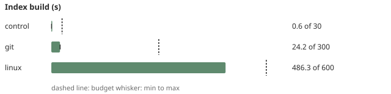

# Benchmark results

Each benchmark run (`make bench`, with `LARGE=1` to add the largest repository)
writes one `<date>-<machine>.json` here plus a folder with its charts, and
`scripts/bench/bench-report.py` regenerates this page. The method, corpus and
budgets are in [docs/benchmarks.md](../../../docs/benchmarks.md).

| Date | Machine | gitterrace | Repos | Files |
| --- | --- | --- | --- | --- |
| 2026-11-13 | Apple M1 Max, 10 cores, 64 GB RAM, macOS 26.6.2 | gitterrace v0.1.0-46ca3fd | control, git, linux | [json](2026-11-13-apple-m1-max.json), [charts](2026-11-13-apple-m1-max/) |
| 2026-11-12 | Apple M1 Max, 10 cores, 64 GB RAM, macOS 26.6.2 | gitterrace v0.1.0-548f044 | control, git, rust, linux | [json](2026-11-12-apple-m1-max.json), [charts](2026-11-12-apple-m1-max/) |

## Newest run, 2026-11-13

Run 2026-11-13 on Apple M1 Max, 10 cores, 64 GB RAM, 4.0 TB SSD disk, macOS
26.6.2 (arm64). gitterrace v0.1.0-46ca3fd, git version 2.54.0 (Apple Git-157).
Measured on a quiet machine.

- **rust:** not measured on a quiet machine (other processes used 5 or more
  cores during export, idle), so its numbers are withheld.

| Repo | Metric | Value | Budget | Status | Change against previous |
| --- | --- | --- | --- | --- | --- |
| control | index build | 0.6 s (0.3 to 0.8) | 30 s | pass | 27% faster |
| control | warm page | 145 ms | 300 ms | pass | 7359% slower |
| control | cold page | 156 ms (153 to 161) | 1500 ms | pass | 519% slower |
| control | peak memory | 114 MB | 500 MB | pass | 3% less memory |
| control | export | 38.4 s (37.7 to 38.7) | 60 s | pass | 12% slower |
| git | index build | 24.2 s (24.2 to 24.9) | 300 s | pass | 7% slower |
| git | warm page | 87 ms | 300 ms | pass | unchanged |
| git | cold page | 2378 ms (2377 to 2518) | 3000 ms | pass | 2% faster |
| git | peak memory | 366 MB | 1500 MB | pass | unchanged |
| git | export | 61.3 s (61.0 to 61.7) | 300 s | pass | 11% slower |
| linux | index build | 486.3 s (486.3 to 486.3) | 600 s | pass | 2% slower |
| linux | warm page | 50 ms | 500 ms | pass | 11% slower |
| linux | cold page | 4216 ms (4216 to 4216) | 20000 ms | pass | 8% slower |
| linux | peak memory | 1985 MB | 8000 MB | pass | 2% more memory |
| rust | index build | withheld (load) | - | withheld | - |
| rust | warm page | withheld (load) | - | withheld | - |
| rust | cold page | withheld (load) | - | withheld | - |
| rust | peak memory | withheld (load) | - | withheld | - |
| rust | export | withheld (load) | - | withheld | - |

5 warm runs per page, 60 s idle windows.

### control

small repository, measured at the run of 2026-11-13. All 7 metrics are within
budget. Against budget: export 38.4 s (37.7 to 38.7) of 60 s, idle footprint
above a fresh server 13 MB of 48 MB, idle CPU 0.08 % of 1 %, index build 0.6 s
(0.3 to 0.8) of 30 s, cold page 156 ms (153 to 161) of 1500 ms, warm page 145 ms
of 300 ms, peak memory 114 MB of 500 MB.

Idle CPU is the larger of two windows: 0.07 % with no client and 0.08 % with one
/events client.

### git

medium repository, measured at `50fe5cc63f`. All 7 metrics are within budget.
Against budget: export 61.3 s (61.0 to 61.7) of 300 s, idle footprint above a
fresh server 8 MB of 48 MB, idle CPU 0.05 % of 1 %, index build 24.2 s (24.2 to
24.9) of 300 s, cold page 2378 ms (2377 to 2518) of 3000 ms, warm page 87 ms of
300 ms, peak memory 366 MB of 1500 MB.

Idle CPU is the larger of two windows: 0.05 % with no client and 0.02 % with one
/events client.

### linux

huge repository, measured at `cbbddb6b08`. All 6 metrics are within budget.
Against budget: idle footprint above a fresh server 21 MB of 48 MB, idle CPU
0.12 % of 1 %, index build 486.3 s (486.3 to 486.3) of 600 s, cold page 4216 ms
(4216 to 4216) of 20000 ms, warm page 50 ms of 500 ms, peak memory 1985 MB of
8000 MB.

Idle CPU is the larger of two windows: 0.12 % with no client and 0.02 % with one
/events client.

| Repo | Class | Measured at | Index | Peak RSS | Cache | RSS after pages | Idle footprint, total | Idle CPU | Idle CPU with /events | Export | Cold samples |
| --- | --- | --- | --- | --- | --- | --- | --- | --- | --- | --- | --- |
| control | small | the run of 2026-11-13 | 0.6 s | 135 MB | 1 MB | 55 MB | 18 MB | 0.07% | 0.08% | 38.4 s, 131 MB | median of 3 |
| git | medium | `50fe5cc63f` | 24.2 s | 664 MB | 45 MB | 362 MB | 13 MB | 0.05% | 0.02% | 61.3 s, 269 MB | median of 3 |
| linux | huge | `cbbddb6b08` | 486.3 s | 8226 MB | 1469 MB | 6601 MB | 26 MB | 0.12% | 0.02% | 1456.9 s, 1 run, 7094 MB | 1 sample |
| rust | large | `f90a2d27c2` | withheld (load) | withheld (load) | withheld (load) | withheld (load) | withheld (load) | withheld (load) | withheld (load) | withheld (load) | median of 3 |

Warm page time per page kind (median), so each column compares one page:

| Page | control | git | linux |
| --- | --- | --- | --- |
| blame-long-history | 1 ms | 87 ms | 19 ms |
| blob-largest | 2 ms | 13 ms | 13 ms |
| commit-largest | 145 ms | 1 ms | 3 ms |
| diff-fragment | 4 ms | 3 ms | 50 ms |
| log | 1 ms | 2 ms | 5 ms |
| overview | 2 ms | 4 ms | 11 ms |
| refs | 1 ms | 1 ms | 2 ms |
| search | 1 ms | 1 ms | 1 ms |
| stats-overview | 0 ms | 1 ms | 1 ms |
| stats/contributors | 0 ms | 1 ms | 0 ms |
| stats/hotspots | 1 ms | 1 ms | 1 ms |
| stats/languages | 1 ms | 1 ms | 1 ms |
| stats/ownership | 0 ms | 0 ms | 1 ms |
| tree-deep | 1 ms | 0 ms | 1 ms |
| tree-root | 0 ms | 1 ms | 1 ms |

control is a working checkout, so with a tab open the server also checks it for
uncommitted changes every second. git, linux, rust are bare clones with no
working tree, so they have nothing to check and idle lower.

<picture>
<source media="(prefers-color-scheme: dark)" srcset="2026-11-13-apple-m1-max/page_warm_ms-dark.svg">

</picture>

<picture>
<source media="(prefers-color-scheme: dark)" srcset="2026-11-13-apple-m1-max/page_cold_ms-dark.svg">

</picture>

<picture>
<source media="(prefers-color-scheme: dark)" srcset="2026-11-13-apple-m1-max/index_secs-dark.svg">

</picture>

<picture>
<source media="(prefers-color-scheme: dark)" srcset="2026-11-13-apple-m1-max/idle_cpu_pct-dark.svg">

</picture>

<picture>
<source media="(prefers-color-scheme: dark)" srcset="2026-11-13-apple-m1-max/rss_mb-dark.svg">

</picture>

<picture>
<source media="(prefers-color-scheme: dark)" srcset="2026-11-13-apple-m1-max/footprint_idle_mb-dark.svg">

</picture>

<picture>
<source media="(prefers-color-scheme: dark)" srcset="2026-11-13-apple-m1-max/export_secs-dark.svg">

</picture>

### Compared with 2026-11-12

The previous run, on Apple M1 Max, 10 cores, 64 GB RAM, 4.0 TB SSD disk, macOS
26.6.2 (arm64). Measured on a quiet machine. Its charts stay beside its result
file. On the charts above, a hollow marker shows its value.

| Repo | Metric | 2026-11-12 | 2026-11-13 | Change |
| --- | --- | --- | --- | --- |
| control | export | 34.4 s | 38.4 s | 12% slower |
| control | idle footprint above a fresh server | 7 MB | 13 MB | 81% more memory |
| control | idle CPU | 0.08 % | 0.08 % | unchanged |
| control | index build | 0.8 s | 0.6 s | 27% faster |
| control | cold page | 25 ms | 156 ms | 519% slower |
| control | warm page | 2 ms | 145 ms | 7359% slower |
| control | peak memory | 117 MB | 114 MB | 3% less memory |
| git | export | 55.1 s | 61.3 s | 11% slower |
| git | idle footprint above a fresh server | 8 MB | 8 MB | 2% less memory |
| git | idle CPU | 0.03 % | 0.05 % | 67% more CPU |
| git | index build | 22.6 s | 24.2 s | 7% slower |
| git | cold page | 2427 ms | 2378 ms | 2% faster |
| git | warm page | 87 ms | 87 ms | unchanged |
| git | peak memory | 366 MB | 366 MB | unchanged |
| linux | idle footprint above a fresh server | 21 MB | 21 MB | unchanged |
| linux | idle CPU | 0.05 % | 0.12 % | 140% more CPU |
| linux | index build | 477.0 s | 486.3 s | 2% slower |
| linux | cold page | 3887 ms | 4216 ms | 8% slower |
| linux | warm page | 45 ms | 50 ms | 11% slower |
| linux | peak memory | 1937 MB | 1985 MB | 2% more memory |

control: every page

Probes: `crates/gitterrace-web/tests/golden/revisions.txt` (largest text file),
commit the run of 2026-11-13.

| Page | Cold | Warm TTFB | Warm full (median) | min | max | Bytes | Previous warm |
| --- | --- | --- | --- | --- | --- | --- | --- |
| blame-long-history | 3 ms | 0 ms | 1 ms | 1 ms | 1 ms | 342900 | 1 ms |
| blob-largest | 2 ms | 2 ms | 2 ms | 2 ms | 2 ms | 180995 | 1 ms |
| commit-largest | 156 ms | 144 ms | 145 ms | 139 ms | 153 ms | 926412 | 1 ms |
| diff-fragment | 4 ms | 4 ms | 4 ms | 4 ms | 5 ms | 3655 | 2 ms |
| log | 2 ms | 1 ms | 1 ms | 1 ms | 2 ms | 53537 | 1 ms |
| overview | 13 ms | 2 ms | 2 ms | 2 ms | 2 ms | 38104 | 2 ms |
| refs | 1 ms | 1 ms | 1 ms | 1 ms | 1 ms | 19233 | 1 ms |
| search | 24 ms | 1 ms | 1 ms | 1 ms | 1 ms | 345315 | 1 ms |
| stats-overview | 1 ms | 0 ms | 0 ms | 0 ms | 1 ms | 121643 | 1 ms |
| stats/contributors | 0 ms | 0 ms | 0 ms | 0 ms | 0 ms | 21505 | 0 ms |
| stats/hotspots | 1 ms | 0 ms | 1 ms | 1 ms | 1 ms | 258483 | 0 ms |
| stats/languages | 1 ms | 1 ms | 1 ms | 1 ms | 1 ms | 442672 | 1 ms |
| stats/ownership | 1 ms | 0 ms | 0 ms | 0 ms | 0 ms | 28334 | 0 ms |
| tree-deep | 1 ms | 1 ms | 1 ms | 1 ms | 1 ms | 19325 | 1 ms |
| tree-root | 2 ms | 0 ms | 0 ms | 0 ms | 1 ms | 34396 | 1 ms |

| Budget | Value | Limit | Status |
| --- | --- | --- | --- |
| export_secs | 38.4 | 60 | pass |
| footprint_idle_mb | 13.1 | 48 | pass |
| idle_cpu_pct | 0.1 | 1 | pass |
| index_secs | 0.6 | 30 | pass |
| page_cold_ms | 155.8 | 1500 | pass |
| page_warm_ms | 144.7 | 300 | pass |
| rss_mb | 114.0 | 500 | pass |

git: every page

Probes: `po/bg.po` (largest text file), commit `50fe5cc63f`.

| Page | Cold | Warm TTFB | Warm full (median) | min | max | Bytes | Previous warm |
| --- | --- | --- | --- | --- | --- | --- | --- |
| blame-long-history | 2.38 s | 83 ms | 87 ms | 86 ms | 89 ms | 9620996 | 87 ms |
| blob-largest | 13 ms | 12 ms | 13 ms | 12 ms | 13 ms | 1760757 | 12 ms |
| commit-largest | 5 ms | 1 ms | 1 ms | 0 ms | 1 ms | 22824 | 0 ms |
| diff-fragment | 3 ms | 3 ms | 3 ms | 3 ms | 3 ms | 4232 | 3 ms |
| log | 2 ms | 2 ms | 2 ms | 2 ms | 2 ms | 51374 | 2 ms |
| overview | 122 ms | 4 ms | 4 ms | 4 ms | 4 ms | 148717 | 4 ms |
| refs | 1 ms | 1 ms | 1 ms | 1 ms | 1 ms | 17994 | 1 ms |
| search | 47 ms | 1 ms | 1 ms | 1 ms | 1 ms | 247609 | 1 ms |
| stats-overview | 72 ms | 0 ms | 1 ms | 0 ms | 1 ms | 134835 | 1 ms |
| stats/contributors | 14 ms | 1 ms | 1 ms | 1 ms | 1 ms | 95739 | 1 ms |
| stats/hotspots | 38 ms | 1 ms | 1 ms | 1 ms | 1 ms | 222787 | 1 ms |
| stats/languages | 121 ms | 1 ms | 1 ms | 1 ms | 1 ms | 409501 | 1 ms |
| stats/ownership | 9 ms | 0 ms | 0 ms | 0 ms | 1 ms | 36007 | 0 ms |
| tree-deep | 1 ms | 0 ms | 0 ms | 0 ms | 0 ms | 18532 | 0 ms |
| tree-root | 4 ms | 1 ms | 1 ms | 1 ms | 1 ms | 145210 | 1 ms |

| Budget | Value | Limit | Status |
| --- | --- | --- | --- |
| export_secs | 61.3 | 300 | pass |
| footprint_idle_mb | 8.2 | 48 | pass |
| idle_cpu_pct | 0.1 | 1 | pass |
| index_secs | 24.2 | 300 | pass |
| page_cold_ms | 2378.3 | 3000 | pass |
| page_warm_ms | 87.0 | 300 | pass |
| rss_mb | 366.0 | 1500 | pass |

linux: every page

Probes: `drivers/gpu/drm/amd/include/asic_reg/nbio/nbio_6_1_default.h` (largest
text file), commit `cbbddb6b08`.

| Page | Cold | Warm TTFB | Warm full (median) | min | max | Bytes | Previous warm |
| --- | --- | --- | --- | --- | --- | --- | --- |
| blame-long-history | 487 ms | 17 ms | 19 ms | 19 ms | 20 ms | 4475389 | 18 ms |
| blob-largest | 12 ms | 12 ms | 13 ms | 12 ms | 13 ms | 2785160 | 12 ms |
| commit-largest | 72 ms | 3 ms | 3 ms | 3 ms | 3 ms | 156404 | 2 ms |
| diff-fragment | 49 ms | 50 ms | 50 ms | 49 ms | 52 ms | 1684 | 45 ms |
| log | 5 ms | 5 ms | 5 ms | 5 ms | 5 ms | 55167 | 5 ms |
| overview | 4.22 s | 11 ms | 11 ms | 8 ms | 18 ms | 36249 | 7 ms |
| refs | 2 ms | 2 ms | 2 ms | 2 ms | 2 ms | 18225 | 2 ms |
| search | 257 ms | 1 ms | 1 ms | 1 ms | 1 ms | 359157 | 1 ms |
| stats-overview | 3.06 s | 1 ms | 1 ms | 1 ms | 3 ms | 181901 | 1 ms |
| stats/contributors | 714 ms | 0 ms | 0 ms | 0 ms | 1 ms | 132464 | 1 ms |
| stats/hotspots | 2.03 s | 1 ms | 1 ms | 1 ms | 3 ms | 254523 | 1 ms |
| stats/languages | 1.63 s | 1 ms | 1 ms | 1 ms | 1 ms | 480665 | 1 ms |
| stats/ownership | 618 ms | 1 ms | 1 ms | 0 ms | 1 ms | 35872 | 1 ms |
| tree-deep | 3 ms | 1 ms | 1 ms | 1 ms | 1 ms | 29262 | 1 ms |
| tree-root | 5 ms | 1 ms | 1 ms | 1 ms | 1 ms | 32582 | 1 ms |

| Budget | Value | Limit | Status |
| --- | --- | --- | --- |
| footprint_idle_mb | 21.2 | 48 | pass |
| idle_cpu_pct | 0.1 | 1 | pass |
| index_secs | 486.3 | 600 | pass |
| page_cold_ms | 4216.0 | 20000 | pass |
| page_warm_ms | 50.0 | 500 | pass |
| rss_mb | 1985.0 | 8000 | pass |

